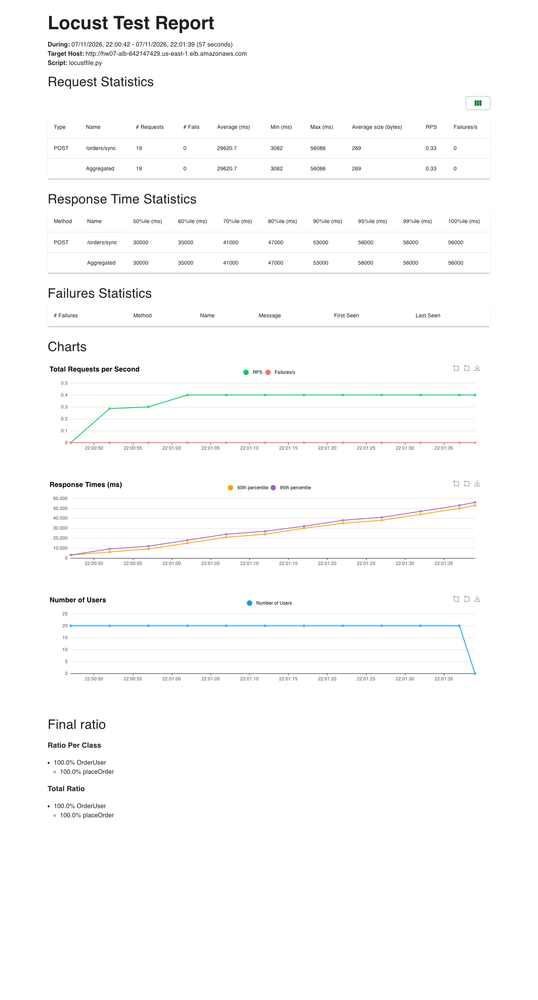
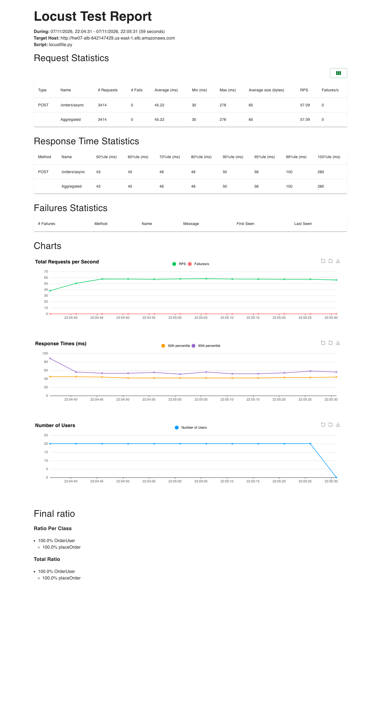
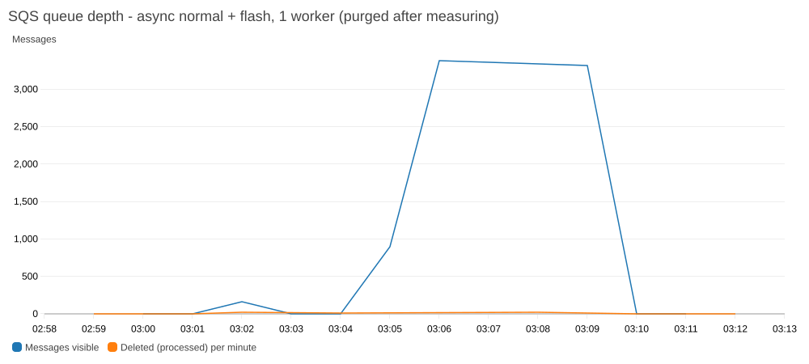
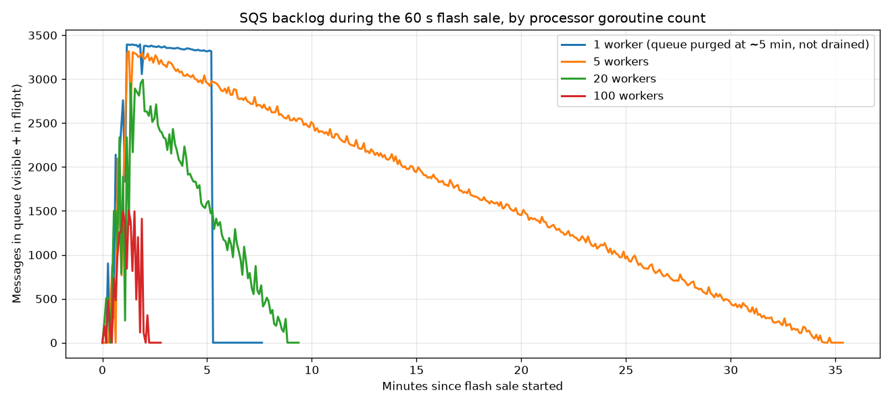
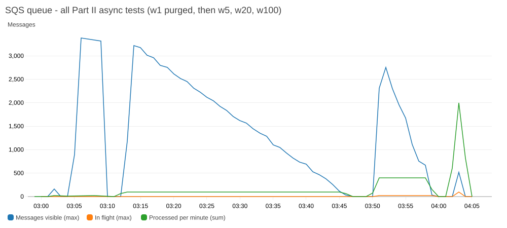
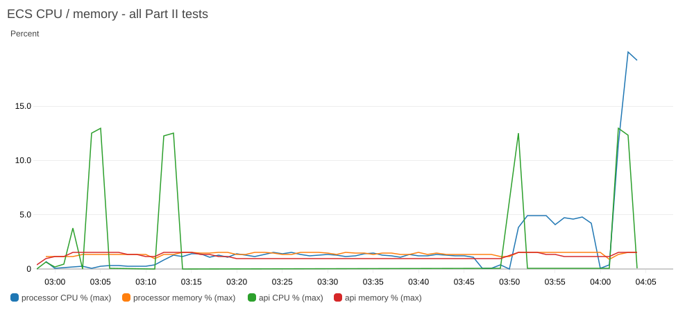
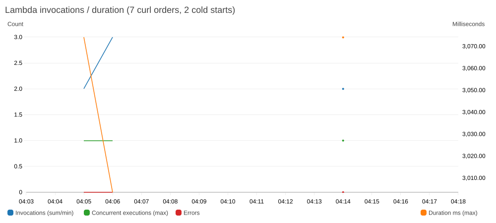

# CS6650 HW7 – Sync vs Async Order Processing: Parts II & III

**Author:** Nikhil Shivakumar (my section of the team report)
**Test date:** 2026-11-08 (all times UTC), AWS Academy Learner Lab, `us-east-1`

Raw artifacts are all in [`results/`](results/): Locust HTML/CSV reports, 5-second SQS queue-depth samples,
CloudWatch PNG graphs, processor/API/Lambda logs, and curl output. Build, deploy, test and teardown
steps are in [README.md](README.md).

---

## 1. Setup

| Component | Configuration |
|---|---|
| Network | VPC `10.0.0.0/16`; public subnets `10.0.1.0/24`, `10.0.2.0/24` (ALB, NAT); private subnets `10.0.10.0/24`, `10.0.11.0/24` (ECS). One NAT gateway shared by both private subnets |
| Load balancer | Internet-facing ALB, HTTP :80 → target group :8080, health check `GET /health`, deregistration delay 5 s, idle timeout 60 s |
| Order API (`service/`) | Go, ECS Fargate, 256 CPU / 512 MB, 1 task, private subnets. `POST /orders/sync`, `POST /orders/async`, `GET /health` |
| Order processor (`processor/`) | Go, ECS Fargate, 256 CPU / 512 MB, 1 task. Long-polls SQS (20 s wait, ≤10 msgs), one goroutine per message, `WORKER_COUNT` env var bounds concurrency |
| Messaging | SNS topic `order-processing-events` → SQS queue `order-processing-queue` (visibility 30 s, retention 4 days, receive wait 20 s) |
| Lambda (Part III) | Go, `provided.al2`, x86_64, 512 MB, 10 s timeout, subscribed directly to the SNS topic |
| Images | Multi-stage build, `distroless/static` base, ~19 MB, `linux/amd64`; ECR lifecycle keeps the last 3 images |
| IAM | Existing `LabRole` for the ECS task role, ECS execution role and Lambda role (no IAM created) |
| Observability | Default CloudWatch metrics only (Container Insights off), log retention 1 day |
| Load generator | Locust 2.47, run headless from my laptop, `wait_time = between(0.1, 0.5)` |

**Simulated payment processor.** Both paths use the same 3 s payment step.
- **Sync:** the API holds a package-level buffered channel `paymentSlots = make(chan struct{}, PAYMENT_CONCURRENCY)`
  (capacity **1**, matching a single-threaded payment provider). A request must put a token into the channel
  before its 3 s payment and remove it afterwards, so every other request blocks in the handler. Throughput
  is capped at `capacity / 3 s` no matter how many goroutines `net/http` starts. A bare `time.Sleep` would not
  cap anything, because every request would sleep in parallel.
- **Async:** the handler publishes the order JSON to SNS and returns **202 Accepted** right away. The processor
  takes a slot in a `WORKER_COUNT`-sized semaphore channel for each message, sleeps 3 s, then deletes the message.
  It only asks SQS for as many messages as it has free workers, so messages never sit invisible in memory
  waiting for a worker.

The `Order` struct (from the assignment) is used by the API, the processor and the Lambda:

```go
type Order struct {
    OrderID    string    `json:"order_id"`
    CustomerID int       `json:"customer_id"`
    Status     string    `json:"status"` // pending, processing, completed
    Items      []Item    `json:"items"`
    CreatedAt  time.Time `json:"created_at"`
}
```

## 2. Architecture

```
                    ┌────────────────────────── VPC 10.0.0.0/16 ──────────────────────────┐
                    │  public 10.0.1.0/24, 10.0.2.0/24        private 10.0.10.0/24, 10.0.11.0/24 │
 Locust / curl ──►  │  ALB :80 ────────────────────────────►  order-api (Fargate)          │
                    │                                           │  /orders/sync: buffered  │
                    │                                           │  channel, 3 s, 200 OK    │
                    │  NAT GW ◄──── egress to AWS APIs ─────────┤  /orders/async: Publish  │
                    │                                           ▼          202 Accepted    │
                    └───────────────────────────────────────────┼──────────────────────────┘
                                                                ▼
                                         SNS order-processing-events
                                          │                        ┆ (Part III only; disabled
                                          ▼                        ┆  during every load test)
                               SQS order-processing-queue     Lambda hw07-order-lambda
                                          │ long poll 20 s, ≤10 msgs     (3 s per order)
                                          ▼
                               order-processor (Fargate, private subnet)
                               WORKER_COUNT goroutines × 3 s each
```

Smoke test (`results/smoke_test_curl.txt`): `/health` → 200, `/orders/sync` → 200 in 3.06 s,
`/orders/async` → 202 in 0.12 s.

---

## 3. Phase 1 – Synchronous baseline (results)

| Test | Users / spawn / duration | Requests completed | Failures | Throughput | Median | p95 | Max |
|---|---|---|---|---|---|---|---|
| sync normal | 5 / 1 s / 30 s | 9 | 0 | **0.33 req/s** | 12.0 s | 15.0 s | 14.7 s |
| sync flash | 20 / 10 s / 60 s | 19 | 0 | **0.33 req/s** | 30.0 s | 56.0 s | 56.1 s |



The sync endpoint completed exactly one order every 3 s in both tests, whatever the load. In the flash test,
latency climbed in a straight line from 3 s to 56 s (see the response-time chart). Every new customer joins
the back of the payment line. When Locust stopped, about 20 requests were still waiting and never completed.
Any request that waits past 60 s gets a 504 from the ALB idle timeout. The API container was nearly idle
(CPU < 4 %, `results/graphs/ecs_cpu_mem_sync.png`): the bottleneck is the payment step, not the compute.
([sync normal report](results/screenshots/locust_sync_normal.png))

**Normal operations (expected: 100 % success rate):** met. 9 of 9 requests succeeded (0 failures), but
"success" took 3–15 s each, because 5 users shared one payment slot.

**Flash sale – "What happens to your customers?"** They wait in line. Only 19 orders completed in 60 s
(1 every 3 s) while 20 users kept clicking. The median customer waited **30 s**, and the slowest **56 s**,
which is right at the ALB's 60 s timeout; any later request would have failed with a 504. The ~20 requests
still waiting when the test ended never completed. In a real shop, those customers would time out,
refresh and resubmit (which makes the line longer), or leave. Nothing errored on our side, but the
system is effectively down for almost everyone.

## 4. Phase 2 – Analyze the bottleneck

### Handout blanks

| Blank | Answer | Observed |
|---|---|---|
| Payment processor speed | 1 order per 3 s | 3.00 s per order (sync min latency 3.08 s incl. network) |
| With 20 concurrent customers: Maximum throughput = _ orders/second | **0.33 orders/s.** The payment step is serialized, so concurrency doesn't help: 20 customers still get 1 / 3 s | **0.33 req/s** (19 orders in 57 s) |
| Flash sale demand | 20 orders/s (given) | – |
| Orders lost per second = _ | 20 − 0.33 = **19.67 orders/s** (98.3 % of demand not served) | sync users sent only 19 requests in 60 s; the rest of the demand was never served |

**"You can't make payment processing faster, so what CAN you change?"** When and where the customer
waits. Accept the order immediately (persist it to a durable queue and return 202), then process payments
in the background at whatever rate the processor allows (Phase 3). You can also increase how many payments
run *in parallel* (workers, Phase 5) if the provider allows concurrent calls.

**Note on the demand figure.** The handout uses 20 orders/s for the flash sale (and 60/s in the Part II
story). What Locust actually generated with 20 users and 100–500 ms waits was higher. Once the API stopped
blocking, it measured **57 orders/s**, which is the ~60/s scenario. With that demand, orders lost =
57 − 0.33 ≈ 56.8/s. Both versions are in the table below.

### Supporting math and measurements

Arrival rate per Locust user = 1 / (response time + mean wait). Mean wait is (0.1 + 0.5) / 2 = 0.3 s.

| Quantity | Theory | Observed |
|---|---|---|
| Customer order rate, normal (5 users) | if the API answered instantly: 5 / (0.045 + 0.3) ≈ **14.5 orders/s** | 13.4 orders/s on `/orders/async` (400 orders in 30 s) |
| Customer order rate, flash sale (20 users) | 20 / (0.045 + 0.3) ≈ **58 orders/s** (~60/s) | **57.1 orders/s** on `/orders/async` (≈3,415 orders in 60 s) |
| Payment processing time per order | 3 s | 3.00 s (sync min latency 3.08 s incl. network; Lambda duration 3,002 ms) |
| Payment processor capacity (1 slot) | 1 / 3 s = **0.33 orders/s** (20 orders/min) | **0.33 req/s** in both sync tests |
| Capacity gap during the flash sale | 58 / 0.33 ≈ **174× more demand than capacity** | 57.1 / 0.33 = 171× |
| Orders the sync API completes in the 60 s flash sale | 60 / 3 = **20** | **19** completed (the 20th was in flight at stop) |
| Orders customers tried to place in 60 s | ≈ 3,480 | ≈ 3,415 (measured on async) |
| Customers lost / waiting with sync | ≈ 3,460 orders (99.4 %) never even get a response | sync users were stuck waiting 30–56 s, so they sent only 19 requests |
| Wait for the *n*-th customer in line | n × 3 s, so the 20th customer waits 60 s → ALB 504 timeout | max 56 s, rising linearly (Locust chart) |
| Concurrent requests held open (Little's Law L = λW) | sync: L = 0.33/s × up to 60 s ≈ all 20 users blocked at once | all 20 Locust users stayed blocked inside a request for the whole test |

**Conclusion:** synchronous processing ties the customer's response time to the slowest downstream dependency.
With a 3 s single-slot payment provider, the system serves 0.33 orders/s against ~58 orders/s of demand.
Adding API tasks won't help: each one gets its own token and still serves 0.33/s, and the real limit is
the payment provider.

## 5. Phase 3 – Async: accept fast, process later (results)

| Test (processor = 1 worker) | Requests | Failures | Throughput | Median | p95 | p99 | Max |
|---|---|---|---|---|---|---|---|
| async normal (5 users, 30 s) | 400 | 0 | 13.4 req/s | 44 ms | 61 ms | 97 ms | 210 ms |
| async flash (20 users, 60 s) | 3,414 | 0 | 57.1 req/s | 43 ms | 56 ms | 100 ms | 276 ms |



`POST /orders/async` answered every order in ~45 ms with 0 errors: **~170× the throughput of sync and ~700×
lower median latency**. All four flash-sale runs (1/5/20/100 workers) showed the same API numbers (57.0–57.2 req/s,
median 43 ms), so the API side does not depend on how fast orders are processed. The cost is that the work
has moved into the queue.

## 6. Phase 4 – The queue problem (1 worker)

With one goroutine the processor clears 1 order per 3 s. Processor logs show exactly 5 orders per 15 s
(`results/logs/processor_w1.log`: `processed=77 → 82 → 87 …`).



### Handout blanks

| Blank | Answer | Observed |
|---|---|---|
| Order acceptance rate | ~60/s (given) | **57.1/s**, 100 % accepted (3,414 / 3,414) |
| Single worker processing rate | 1 order per 3 s = 0.33/s (given) | **0.333/s** (exactly 5 per 15 s in the processor logs) |
| Queue growth rate = _ messages/second | 60 − 0.33 = **59.67 msgs/s** | 57.1 − 0.33 = **56.8 msgs/s**; the queue reached 3,396 after the 60 s sale |
| Time to clear backlog = _ minutes | **Our 60 s test:** 3,580 msgs ÷ 0.33/s ≈ 10,740 s ≈ **179 min (~3 h)** | **Measured peak 3,396 × 3 s = 10,188 s ≈ 170 min (2 h 50 min).** Calculated, not waited for. During the 4 min after the sale the backlog fell only 3,396 → 3,316 (20/min), which confirms the rate. Then purged. |
| Same, for the story's full **one-hour** flash sale | 59.67 × 3,600 ≈ 214,800 msgs ÷ 0.33/s ≈ 644,400 s ≈ **10,740 min ≈ 7.5 days** | not run. That is longer than the queue's 4-day retention, so about half the orders would **expire unprocessed** |

**"Where's my order confirmation?"** With 1 worker, the last flash-sale customer gets their confirmation
almost 3 hours after clicking "buy". For a full one-hour sale it would be a week, or never, past the 4-day retention.

### Supporting measurements

| Quantity | Theory | Observed |
|---|---|---|
| Arrival rate during the flash sale | ≈ 58 msgs/s | 57.1 msgs/s |
| Processing rate (1 worker) | 1 / 3 s = 0.33 msgs/s (20/min) | 0.333 msgs/s (5 per 15 s); CloudWatch `NumberOfMessagesDeleted` ≈ 20/min |
| Net queue growth during the sale | 58 − 0.33 ≈ **+57.7 msgs/s** | +56.7 msgs/s |
| Peak queue depth after 60 s | 60 × 57.7 ≈ **3,460** | **3,396** (5 s samples), 3,384 on CloudWatch |
| Time to drain the peak | 3,396 × 3 s = **10,188 s ≈ 2 h 50 min** | Not waited (it would take ~2.8 h). Over 4 min after the sale the backlog fell only 3,396 → 3,316 (≈ 20/min), which confirms the rate. Queue purged at 03:09:46. |
| Time for the *last* customer's order to complete | ≈ 2.8 h after they clicked "buy" | same (calculated) |
| Async normal (5 users) backlog, 1 worker | 30 × (14.5 − 0.33) ≈ 425 | ~380 visible after the 30 s run, purged |
| Processor CPU / memory with 1 worker | very low; sleeping goroutines use no CPU | CPU max 0.34 %, memory max 1.4 % |

**What this shows:** async fixed the *customer-facing* problem (202 in 45 ms) but not the *throughput*
problem. The 3,400 orders are durable in SQS (4-day retention), so none are lost. Customers would just
see a confirmation e-mail almost 3 hours later. A queue absorbs bursts. It does not create capacity.
The only way the backlog clears is if processing rate > arrival rate on average.

## 7. Phase 5 – Worker scaling (async flash test, 20 users / 60 s)

The worker count changes only the processor task's `WORKER_COUNT` env var
(`terraform apply -target=aws_ecs_service.processor -var worker_count=N`), redeploying only that service
(min healthy 0 %, so two worker pools never overlap). Queue depth was sampled every 5 s with
`get-queue-attributes` (visible + in flight) and stopped after the queue had been empty for 30 s.

### Handout blanks

| Goroutines | Processing rate = _ | Observed rate (CloudWatch `NumberOfMessagesDeleted`) |
|---|---|---|
| 5 | 5 / 3 s = **1.67 orders/s** (100/min) | ≈ 100/min ✓ |
| 20 | 20 / 3 s = **6.67 orders/s** (400/min) | ≈ 400/min ✓ |
| 100 | 100 / 3 s = **33.3 orders/s** (2,000/min) | ≈ 2,000/min peak minute ✓ |

**Minimum workers to prevent queue buildup at 60 orders/s:** workers ≥ 60 orders/s × 3 s = **180 goroutines**
(Little's Law: L = λ·W). At our measured 57/s that is 171. With 100 goroutines the queue still grew at
57 − 33 ≈ 24 msgs/s and peaked at 1,507. I'd run ~200–220 for headroom. CPU/memory are not the constraint:
100 goroutines used ≤ 20 % CPU and 1.6 % memory of the 256/512 task.





### Theory

Processing capacity = workers / 3 s. Backlog grows while arrival rate λ ≈ 57/s exceeds capacity μ, so
peak ≈ 60 s × (λ − μ). The queue is empty once all N ≈ 3,415 orders are processed: T_empty ≈ max(60 s, N / μ).

| Workers | Capacity μ | Predicted peak | Predicted time to empty (from sale start) |
|---|---|---|---|
| 1 | 0.33/s (20/min) | 3,400 | 3,415 × 3 = 10,245 s ≈ **2 h 51 min** |
| 5 | 1.67/s (100/min) | 3,320 | 3,415 / 1.67 ≈ 2,049 s ≈ **34 min** |
| 20 | 6.67/s (400/min) | 3,020 | 3,415 / 6.67 ≈ 512 s ≈ **8.5 min** |
| 100 | 33.3/s (2,000/min) | 1,420 | 3,415 / 33.3 ≈ 102 s ≈ **1.7 min** |
| **≈171–180** | **≥ 57–60/s** | **≈ 0 (keeps up)** | **≈ 60 s + 3 s** |

**Workers needed to keep up** (Little's Law, L = λ·W): 57 orders/s × 3 s ≈ **171 concurrent workers**
(**180** for a round 60 orders/s). Add ~20 % headroom and that comes to ~200–220.

### Observed (`results/worker_scaling_summary.csv`)

| Workers | Orders accepted | Peak queue depth | Peak at | Time until queue = 0 (from sale start) | Observed rate | Processor CPU max / avg | Processor mem max | API CPU max |
|---|---|---|---|---|---|---|---|---|
| 1 | 3,414 | **3,396** | +108 s | **≈ 2 h 50 min (calculated; purged)** | 0.33/s | 0.34 % / 0.21 % | 1.37 % | 13.0 % |
| 5 | 3,420 | **3,317** | +76 s | **2,072 s (34 min 32 s)** | 1.67/s (100/min in CloudWatch) | 1.55 % / 1.08 % | 1.56 % | 12.5 % |
| 20 | 3,412 | **2,993** | +116 s | **530 s (8 min 50 s)** | 6.67/s (400/min) | 4.94 % / 3.16 % | 1.56 % | 12.5 % |
| 100 | 3,414 | **1,507** | +75 s | **124 s (2 min 4 s)** | ≈ 33/s (~2,000/min) | 19.98 % / 8.21 % | 1.56 % | 13.0 % |

Per-run graphs: [w5 queue](results/graphs/sqs_async_flash_w5.png) · [w20 queue](results/graphs/sqs_async_flash_w20.png) ·
[w100 queue](results/graphs/sqs_async_flash_w100.png) · [w5 ECS](results/graphs/ecs_cpu_mem_w5.png) ·
[w20 ECS](results/graphs/ecs_cpu_mem_w20.png) · [w100 ECS](results/graphs/ecs_cpu_mem_w100.png) ·
[w1 ECS](results/graphs/ecs_cpu_mem_w1.png) · [ALB requests/latency](results/graphs/alb_requests_latency_part2.png).
Locust reports: [w5](results/screenshots/locust_async_flash_w5.png), [w20](results/screenshots/locust_async_flash_w20.png),
[w100](results/screenshots/locust_async_flash_w100.png).

### Analysis

- **Theory matched measurements within ~5 %.** 5 workers: 2,072 s observed vs 2,049 s predicted. 20 workers:
  530 s vs 512 s. 100 workers: 124 s vs 102 s, where the extra ~20 s is SQS long-poll round trips and the
  `ApproximateNumberOfMessages` reporting lag. Peaks also matched: 3,317 vs 3,320 and 2,993 vs 3,020. The
  100-worker peak (1,507 vs 1,420) fits too, because SQS counts are approximate.
- **Scaling was linear in goroutines.** Each 4–5× increase in workers cut drain time by about 4–5×. The work is
  I/O-bound waiting (3 s sleep that stands in for an external payment call), so goroutines are almost free.
  At 100 workers the 0.25 vCPU task peaked at only 20 % CPU and memory stayed at ~1.6 % of 512 MB
  (≈ 8 MB). One 256-CPU task could probably run the ~180 workers needed to keep up in real time, maybe more.
- **In a real system the limit is not the processor.** It is whatever the 3 s represents: the payment
  provider's rate limit or concurrency cap. Running 180 workers means the payment API must accept 60 req/s.
  If it can't, more workers only cause throttling and retries.
- **Diminishing returns past the arrival rate.** Above ~171 workers the queue stays near zero during the sale.
  Extra workers then just sit idle in long polls, so the right value is λ × processing time + headroom.
  Autoscaling on `ApproximateNumberOfMessagesVisible` (backlog per task) is the production answer.
- **Visibility timeout (30 s) vs processing time (3 s):** safe, because a message is deleted long before it
  could reappear. The processor also only receives as many messages as it has free workers, so with 1 worker
  messages never sit invisible past 30 s and get processed twice. No duplicates were observed.
- **API was unaffected throughout:** 57 req/s, 43 ms median, 0 failures on every run, API CPU ≤ 13 %.

---

## 8. Part III – Lambda (serverless processor)

Lambda `hw07-order-lambda` (Go, `provided.al2`, x86_64, 512 MB, code 2.9 MB) was subscribed directly to the
SNS topic **only after all Part II load tests were finished** (the subscription is a Terraform toggle that
defaulted to off). **No load test was run against Lambda.** I sent 7 orders total with curl through
`POST /orders/async`:

- **Batch 1** (04:05:49–04:06:10): 5 orders, one every 5 s (`results/lambda_curl_batch1.txt`)
- **Idle ~8 min**
- **Batch 2** (04:14:30–04:14:35): 2 orders (`results/lambda_curl_batch2.txt`)

### REPORT lines (`results/lambda_report_lines.txt`, full log `results/logs/lambda_full.log`)

| # | Time (UTC) | Exec env | Duration | Billed | Max mem | Init Duration | Start |
|---|---|---|---|---|---|---|---|
| 1 | 04:05:53 | bd8bf430… | 3,002.28 ms | 3,075 ms | 19 MB | **71.90 ms** | **cold** |
| 2 | 04:05:58 | bd8bf430… | 3,001.54 ms | 3,002 ms | 19 MB | – | warm |
| 3 | 04:06:03 | bd8bf430… | 3,003.50 ms | 3,004 ms | 19 MB | – | warm |
| 4 | 04:06:08 | bd8bf430… | 3,001.69 ms | 3,002 ms | 19 MB | – | warm |
| 5 | 04:06:13 | bd8bf430… | 3,001.52 ms | 3,002 ms | 19 MB | – | warm |
| 6 | 04:14:33 | fb556e08… | 3,002.58 ms | 3,075 ms | 19 MB | **71.50 ms** | **cold** (after 8 min idle) |
| 7 | 04:14:38 | fb556e08… | 3,003.72 ms | 3,004 ms | 19 MB | – | warm |



### Cold vs warm summary

| | Cold (n = 2) | Warm (n = 5) |
|---|---|---|
| Init Duration | 71.5–71.9 ms (avg 71.7 ms) | none |
| Handler duration | 3,002.4 ms avg | 3,002.4 ms avg |
| Billed duration | 3,075 ms | 3,002–3,004 ms |
| Overhead vs warm | +~73 ms billed (≈ 2.4 %) | – |

**Observations**
- Cold starts happened exactly where expected: on the first invocation, and again after ~8 minutes idle, when
  Lambda had recycled the environment (a new log stream `fb556e08…` appeared). Sequential invocations 5 s apart
  reused one environment, so all 4 were warm.
- A Go custom-runtime cold start is tiny (**~72 ms**): a static 6.8 MB binary, no JVM or interpreter, and the
  handler has no SDK clients to set up. The init time is billed (3,075 vs 3,002 ms).
- **Cold starts don't matter for this workload.** The 3 s payment step is 98 % of the cost, and the customer
  never waits on the Lambda anyway: they already got a 202 from the API in ~80–140 ms. Cold-start latency only
  delays when the order is marked completed.
- **Max memory used was 19 MB of 512 MB.** The function is over-provisioned by 27×. Dropping to 128 MB would cut
  cost by 4× (compute is billed per GB-second).
- Lambda gets rid of the worker-count tuning from Phase 5: SNS invokes one concurrent execution per in-flight
  message. During a 58/s flash sale that is ~174 concurrent executions (λ × 3 s), within the default account
  limit of 1,000 (Learner Lab accounts may have a lower limit, one more reason not to load test it here).

### Handout questions

- **How often do cold starts occur?** On the first request, and again after the function had been idle long
  enough for Lambda to reclaim the environment. We saw that after ~8 min idle (2 of 7 invocations were cold).
  Back-to-back requests 5 s apart were all warm. They also happen whenever concurrency rises: each extra concurrent
  execution starts a new environment, so a flash sale would cause a burst of cold starts.
- **What's the overhead?** **71.9 ms and 71.5 ms** Init Duration on a 3,002 ms invocation = **≈ 2.4 %**
  (billed 3,075 ms vs 3,002 ms warm). This matches the handout's 73 ms / 2.4 % almost exactly.
- **Does this matter for 3-second payment processing?** No. The overhead is small next to the 3 s payment, and the
  customer doesn't wait on it: they already got the 202 from the API in 80–140 ms. A cold start only delays the
  background confirmation by ~70 ms.

## 9. Cost analysis: ECS vs Lambda

Pricing (us-east-1, x86): Lambda **$0.0000166667 per GB-s** + **$0.20 per 1M requests**. Free tier:
1M requests + 400,000 GB-s per month. Part II cost (from the handout): **2 ECS tasks × $8.50/month = $17/month**,
always running. That is the same at 0 orders or at millions of orders, since one task can run hundreds of goroutines.

**Handout example: 10,000 orders/month, 3 s, 512 MB.** Requests: 10,000 < 1M free. GB-s: 10,000 × 3 × 0.5 = 15,000
< 400K free. **Lambda = $0/month vs ECS $17/month.**

**My expected volume.** Two ~1-minute flash sales per week at our measured ~3,400 orders each, plus normal traffic
of ~5 orders/s for ~2 busy hours a day (≈ 36,000/day), comes to ≈ **1.1 M orders/month**. That gives
1.1 M × 1.5 GB-s = 1.65 M GB-s → (1.65 M − 0.4 M) × $0.0000166667 ≈ **$20.83 compute** + (1.1 M − 1 M) × $0.20/M ≈ **$0.02
requests → ≈ $20.85/month on Lambda at 512 MB** (vs $17 ECS). At 128 MB (our real usage is 19 MB) it is
0.4125 M GB-s → ≈ $0.21 compute + $0.02 requests ≈ **$0.23/month**.

**Cost per order on Lambda (512 MB, 3.0 s billed):**
- Compute: 0.5 GB × 3.002 s = 1.501 GB-s × $0.0000166667 = **$0.00002502**
- Request: $0.20 / 1,000,000 = **$0.00000020**
- **Total ≈ $0.0000252 per order** (≈ $25.22 per million orders)

**Break-even (Lambda cost = $17):**
- Without free tier: 17 / 0.0000252 ≈ **674,000 orders/month** ≈ 22,500/day ≈ **0.26 orders/s on average**
- With free tier: the GB-s allowance covers 400,000 / 1.501 ≈ 266,500 orders free, so break-even ≈ **940,000 orders/month**
- Right-sized to 128 MB (we only use 19 MB): $0.00000645 per order, so break-even ≈ **2.6 M orders/month**
  (≈ 1 order/s sustained) without the free tier, ≈ 3.7 M with it

**Comparing with the handout's break-even.** The handout gets the same ~267K free orders (400K ÷ 1.5 GB-s) but
says ~1.7M requests/month to reach $17. My calculation reaches $17 sooner. Past the free tier, each order costs
1.5 GB-s × $0.0000166667 + $0.0000002 ≈ $0.0000252, so $17 buys 17 / 0.0000252 ≈ **674K paid orders**, and the total is
267K + 674K ≈ **~940K orders/month** (requests stay under the 1M free tier until then). Getting to ~1.7M would need
roughly half the per-order compute, about 0.75 GB-s, for example 256 MB at 3 s. Either way the conclusion is the same: Lambda is
free below ~267K orders/month and cheaper than ECS below roughly 1M (512 MB) to 3.7M (128 MB) orders/month.

| Monthly orders | Lambda 512 MB (no free tier) | Lambda 128 MB (no free tier) | ECS |
|---|---|---|---|
| 10,000 | $0.25 | $0.06 | $17 |
| 100,000 | $2.52 | $0.65 | $17 |
| 674,000 | **$17.00** | $4.35 | $17 |
| 1,000,000 | $25.22 | $6.45 | $17 |
| 2,634,000 | $66.42 | **$17.00** | $17 |
| 10,000,000 | $252.17 | $64.54 | $17 (one processor task with a few hundred goroutines keeps up) |

One flash sale like ours (~3,400 orders) costs about **$0.09** on Lambda. The two ECS tasks run 24/7 and
cost ~$0.57/day ($17/month) even when no one is buying.

**Hidden factors**
- **Lambda bills for waiting.** The 3 s is the external payment call. Lambda charges for wall-clock time while
  the function waits on I/O. ECS does it in goroutines that cost almost nothing (100 workers ≈ 20 % of 0.25 vCPU).
  This is why ECS wins at sustained high volume.
- **Operational cost:** ECS needs worker-count tuning (Phase 5), autoscaling policies, image patching and
  capacity planning. Lambda scales per message with no tuning and costs nothing at zero traffic.
- **SNS → Lambda directly drops the queue's buffering.** Bursts become concurrency spikes (throttling past the
  concurrency limit), and SNS retries are limited. SQS → Lambda (event source mapping) keeps durability, DLQ
  support and a `MaximumConcurrency` cap that protects the payment provider.
- The NAT gateway (~$33/month + data) and ALB (~$16/month) are needed for the API either way. They are not part
  of this comparison but are actually the largest line items in this stack.

### Trade-offs from the handout, checked against what we observed

| | Observed / implication |
|---|---|
| Gain: zero operational overhead | True for the processor. No worker counts, no visibility-timeout tuning, no ECS health monitoring. We still ran the API on ECS. |
| Gain: pay only when processing | 7 orders cost ≈ $0.00018. The ECS processor costs ~$0.28/day even at zero orders. |
| Gain: automatic scaling | One execution per in-flight message. No Phase 5 backlog to tune. |
| Lose: no message queuing | With SNS → Lambda directly, a burst past the concurrency limit gets throttled. SNS retries, and then the order is gone. In Part II, SQS held 3,400 orders safely for hours. |
| Lose: retry control | Only SNS's delivery retries, no DLQ unless configured. A payment failure inside the function is just a log line. |
| Lose: batch processing | Each invocation gets one SNS record, while the SQS consumer could receive 10 at a time. |
| Lose: cold starts | ~72 ms / 2.4 %. Negligible here. |

### Switch recommendation

**Yes, switch the order *processor* to Lambda, keep the API on ECS, and keep a queue: put SQS between SNS and
the Lambda (SNS → SQS → Lambda event source mapping) instead of subscribing the Lambda directly to SNS.**

Why:
1. **Our traffic is spiky, not sustained.** Flash sales are short bursts with long idle periods in between. At my
   expected ~1.1 M orders/month, Lambda at 512 MB is ≈ $20.85 (a bit more than ECS's $17). Right-sized to 128 MB,
   which our measured 19 MB peak allows, it is ≈ **$0.23/month**, and break-even rises to ~3.7 M orders/month
   (≈ 1.4 orders/s, every second of the month). Most of the time the ECS tasks sit idle and still cost $17.
   Below ~267K orders/month (the startup phase), Lambda is free even at 512 MB.
2. **Lambda fixes the Phase 4/5 problem with no tuning.** It scaled to the needed concurrency automatically, so
   the 2 h 50 min backlog we saw with 1 worker can't happen, and nobody has to pick 5, 20 or 180 workers.
3. **Cold starts are not a factor:** ~72 ms on a 3 s background job the customer is not waiting for.
4. **Keep SQS in front** so a flash sale queues instead of throttling Lambda, set a `MaximumConcurrency` that
   matches the payment provider's limit, add a DLQ, and right-size memory to 128 MB.

**When I'd switch back to ECS:** once sustained volume goes past ~2–3 M orders/month (≈ 1 order/s around the
clock), or if the payment call gets longer (Lambda cost grows linearly with wait time). At that point
one always-on task with a few hundred goroutines is much cheaper.

---

## 10. Mock interview prep

### Part II questions (from the handout)

**How many times more orders did your asynchronous approach accept compared to your synchronous approach?**
In the same 60 s flash sale with 20 users, async accepted **3,414 orders** (57.1/s, 0 failures, 43 ms median) and
sync completed **19** (0.33/s, 30 s median wait). That is **≈ 180× more**. Per second it is 57.1 / 0.33 ≈ 172×. The
gap is set by the payment step: sync can't beat 1 order per 3 s, while async is limited only by how fast the
API can publish to SNS.

**What causes queue buildup and how do you prevent it?**
The arrival rate is higher than the processing rate. With 1 worker we accepted 57/s but processed 0.33/s, so the
queue grew by ~57 messages/s to 3,396 and needed ~2 h 50 min to drain. To prevent it: run enough concurrent
consumers that processing rate ≥ peak arrival rate (Little's Law: 60/s × 3 s = 180 workers; measured drain
times scaled linearly: 5 → 34.5 min, 20 → 8.8 min, 100 → 2.1 min). Autoscale consumers on queue depth or age of
oldest message. Use Lambda/SQS event sources that scale automatically. Pick a visibility timeout well above
processing time and add a DLQ so poison messages don't recycle. If the downstream (payment) really can't go
faster, add backpressure or rate-limit the front door, and make sure retention (4 days) is longer than the worst-case
backlog (a one-hour sale with 1 worker would take 7.5 days).

**When would you choose sync vs async in production?**
Sync when the caller needs the result to continue and the work is fast and reliably bounded: login, reading
a cart, checking stock before showing "add to cart", or validating a card number. Async when the work is slow or
spiky, depends on a rate-limited third party, or can complete later: payment capture, fulfilment, e-mails,
analytics. Here: validate the order synchronously (cheap), then accept it with 202 and process payment
asynchronously, with an order-status endpoint or notification. The cost of async is eventual results, at-least-once
delivery (so processing must be idempotent), and more moving parts to monitor.

### Part III questions (from the handout)

**How often did cold starts occur? Every few minutes? Every request?**
Not every request. 2 of 7: the first invocation, and the first after ~8 minutes idle. Requests 5 s apart reused
the same warm environment. Under real flash-sale load, cold starts would also happen once per new concurrent
environment as Lambda scales out (~180 of them for 60 orders/s × 3 s).

**Is the cost advantage compelling? For 10,000 orders/month Lambda costs $0 vs ECS $17.**
Yes for low or spiky volume: 10K orders = 15K GB-s, well within the free tier, so $0 vs $17. Lambda stays cheaper
until ~940K orders/month at 512 MB (my break-even, see §9) or ~3.7M at 128 MB. It is less compelling at sustained
high volume, because Lambda bills the 3 s spent *waiting* on the payment provider, which goroutines in ECS do almost for free.

**Can you accept losing SQS guarantees? Messages get 2 retries, then disappear.**
Not for orders. Each one is revenue, and Part II showed SQS keeping 3,400 orders safe through a 3-hour backlog. A throttled
or failed Lambda invocation that runs out of SNS retries is a lost sale with no trace except a log line.
Two fixes: a DLQ on the SNS subscription (a redrive policy) at the very least, or SNS → SQS → Lambda, which keeps
durability, retries, DLQs and batching while still removing the ECS workers.

**Scale consideration: Lambda stays FREE until 267K orders/month.**
Correct: 400K GB-s ÷ 1.5 GB-s per order ≈ 267K. Right-sizing memory to 128 MB (we used 19 MB) raises that to
~1.07M orders/month free. Also watch the account's concurrency limit (default 1,000, often much lower on new or
Learner Lab accounts). 60 orders/s × 3 s needs ~180 concurrent executions.

**Should your startup switch to Lambda? Why or why not?**
Yes, for the processor, behind SQS (see §9). Our load is bursty, so most of the time an ECS task sits idle at $17/month.
Lambda is free or nearly free at startup volume, removes the 3 am queue alerts and manual worker scaling from
Part III's "burnout" list, and its ~72 ms cold start is irrelevant for a 3 s background job. Keeping SQS in front
means we don't trade away the durability that saved us in Part II. Revisit once sustained volume passes ~940K orders/month
(512 MB) or ~3.7M (128 MB), or if the payment call gets much slower.

### Additional prep

**Q1. Why did the synchronous endpoint fail during the flash sale, and why wouldn't adding servers fix it?**
Its throughput is bound by the 3 s, single-slot payment step (0.33 orders/s), while customers sent ~58/s. Each
request holds a connection while it waits in line, so latency grows linearly (n × 3 s) until requests hit the
60 s ALB timeout. More API instances don't add payment capacity. The bottleneck is the downstream dependency,
and the fix is to stop making the customer wait on it.

**Q2. What does the async pattern actually buy you, and what doesn't it buy?**
It decouples *accepting* work from *doing* work: 202 in ~45 ms at 57 req/s with 0 errors, durable storage
of every order (SQS, 4-day retention), and the ability to absorb bursts. It does not add processing capacity.
With 1 worker, the backlog of 3,396 took about 2.8 hours to drain. You still need processing rate ≥ average arrival rate.

**Q3. How many workers do you need, and how do you calculate it?**
Little's Law: concurrency = arrival rate × service time = 57/s × 3 s ≈ 171 (180 for 60/s), plus ~20 % headroom.
Measured drain times matched N / (workers / 3 s) within ~5 % (5 → 34.5 min, 20 → 8.8 min, 100 → 2.1 min).

**Q4. Why use SNS in front of SQS instead of publishing straight to SQS?**
Fan-out. Several independent consumers (fulfilment, e-mail, analytics, or the Lambda in Part III) can
subscribe to one event without the API knowing about them. Each consumer gets its own queue with its own
pace, retries and DLQ. The cost is an extra hop and the SNS JSON envelope (the processor unwraps it).

**Q5. What delivery guarantees do you get, and how do you handle duplicates?**
Standard SQS is at-least-once and unordered. A message can be redelivered if processing exceeds the
visibility timeout or a delete fails. Processing must be idempotent: key on `order_id` and use a conditional
write or a "processed orders" table so a payment is never charged twice. Set visibility timeout well above
processing time (30 s vs 3 s here). Use a DLQ with `maxReceiveCount` for poison messages. Use FIFO queues only
if ordering or exactly-once dedup is worth the throughput limit.

**Q6. How would you autoscale the processor in production?**
Target tracking on backlog per task: `ApproximateNumberOfMessagesVisible / running tasks` against an
acceptable backlog (acceptable latency ÷ per-message time × workers per task). Cap it by what the payment
provider allows. Or move to Lambda with an SQS event source and `MaximumConcurrency`.

**Q7. ECS or Lambda for the processor?**
It depends on utilization. Lambda costs ~$0.0000252 per order at 512 MB (break-even with a $17/month task at
~674 k orders/month; ~2.6 M at 128 MB). It scales to zero, needs no worker tuning, and Go cold starts were ~72 ms.
ECS wins under sustained high load because I/O waits in goroutines are almost free, while Lambda bills
wall-clock time. For spiky flash-sale traffic I'd pick Lambda behind SQS.

**Q8. What would you monitor?**
Queue depth (`ApproximateNumberOfMessagesVisible`) and `ApproximateAgeOfOldestMessage` as the user-facing SLO
for "time until my order is confirmed". Processing rate (`NumberOfMessagesDeleted`) vs arrival rate
(`NumberOfMessagesSent`). DLQ depth. API p99 and 5xx rate. Lambda `Throttles`, `ConcurrentExecutions` and errors.
Payment-provider error and throttle rates.

**Q9. What happens if the processor crashes mid-order?**
The message is never deleted, so it becomes visible again after 30 s and another worker processes it. That is
safe only if processing is idempotent (Q5). The processor also drains in-flight work on SIGTERM
(`wg.Wait()`), so redeploys don't strand messages.

**Q10. What's the trade-off the customer sees?**
Sync gives an immediate, definite answer (paid or not) but collapses under load. Async gives an immediate
"order received" (202) and a later confirmation, so the product needs an order-status endpoint or a
notification, and a way to handle payment failures after the customer has left (cancel and e-mail).

---

## 11. Teammates' results *(placeholder)*

> **TODO – Teammate 1 (name):** Parts II/III results, environment differences, worker-scaling table.
>
> **TODO – Teammate 2 (name):** …
>
> **TODO – Teammate 3 (name):** …

## 12. Cross-team comparison *(placeholder)*

> **TODO (team):** For each metric, say **where results match, where they differ, and why**, and label
> every number with the teammate it came from. Suggested rows: sync throughput and latency (normal and flash),
> async acceptance rate and latency, peak queue depth and time-to-zero for 1/5/20/100 workers, processor
> CPU/memory, Lambda cold-start Init Duration and frequency, break-even and cost for expected volume, and
> each switch recommendation. Likely causes of differences: payment-limiter design (buffered-channel
> capacity, which sets sync throughput), how many messages the processor pulls per receive, Locust client
> location/network latency (sets the async arrival rate), AZ placement, and the CloudWatch 1-minute sampling
> of `ApproximateNumberOfMessagesVisible` vs direct polling. End with a single agreed team recommendation.
>
> My numbers to compare: sync 0.33 req/s; async 57.1 req/s; peaks 3,396 / 3,317 / 2,993 / 1,507;
> drain ≈ 170 min (calc.) / 34.5 / 8.8 / 2.1 min; cold start 71.5–71.9 ms (2 of 7).

---

## Appendix: run timeline and cost hygiene

| Time (UTC) | Event |
|---|---|
| 02:54–02:57 | `terraform apply` (30 resources) |
| 02:59:51 | sync normal |
| 03:00:42 | sync flash |
| 03:01:49 | async normal (1 worker), purged 03:03 |
| 03:04:31 | async flash, 1 worker. Watched until 03:09:46, then purged |
| 03:12:17 → 03:46:49 | async flash, 5 workers, until queue empty |
| 03:50:45 → 03:59:35 | async flash, 20 workers, until queue empty |
| 04:02:38 → 04:04:42 | async flash, 100 workers, until queue empty |
| 04:05:49 / 04:14:30 | Lambda: 5 + 2 curl orders (subscription enabled only now) |
| 04:16:09 → 04:19:56 | `terraform destroy` (38 resources); teardown checked with the AWS CLI (`results/teardown_verification.txt`) |

The whole stack ran for ~85 minutes. The report was written from the saved results after teardown.
