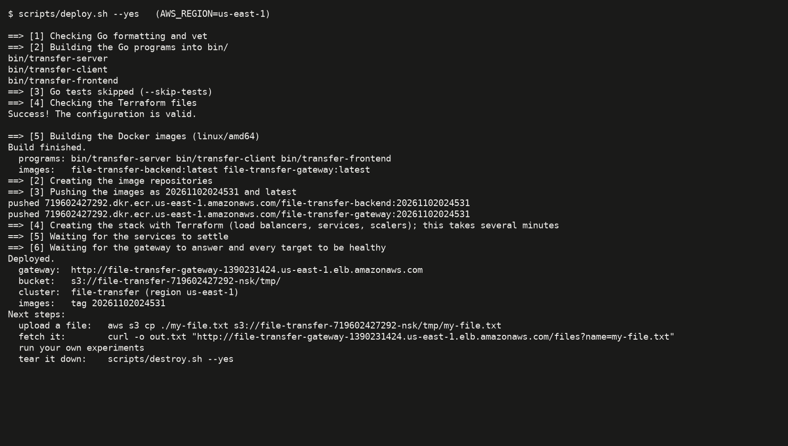
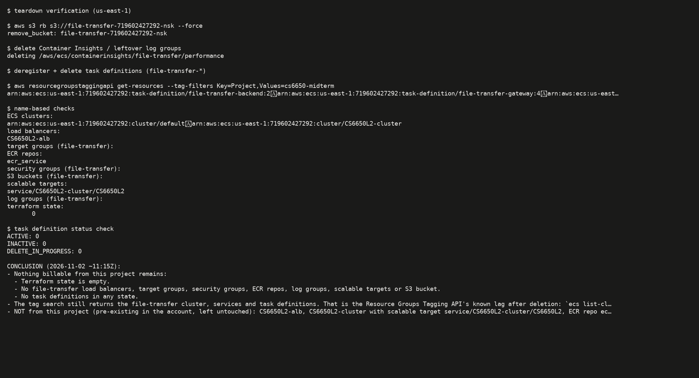

# Nikhil: Midterm Mastery Part 2 (empirical)

CS6650 Fall 2026. Three experiments on the course's **file-transfer play-service**: an HTTP gateway behind an ALB, a UDP backend behind an NLB, and S3. It was deployed on AWS (Learner Lab, us-east-1) and evaluated with Locust, CloudWatch and ECS autoscaling.

- Service fork (instrumented): <https://github.com/nikhilsk98/file-transfer-playservice>, branch `midterm-instrumentation`. The Go source is **not** included here.
- **THE presentation:**
  - slides: [`PRESENTATION_Experiment_Presentation.pptx`](PRESENTATION_Experiment_Presentation.pptx) and [`.pdf`](PRESENTATION_Experiment_Presentation.pdf)
  - timed script: [`PRESENTATION_talking_points.md`](PRESENTATION_talking_points.md)

## Summary of findings

1. **0% simulated loss is not 0% loss on AWS.**
   - The backend sends every 64-byte chunk back-to-back, and the receiving side loses **11% of a 64 KB burst and ~35% of a 1 MB burst** before any simulated loss.
   - The loss is not caused by the NLB (it persists with the NLB bypassed) or by gateway CPU (it persists at 1 vCPU).
   - So file size amplifies loss far beyond the per-datagram rate. Details: [notes/native-loss-diagnosis.md](notes/native-loss-diagnosis.md).
2. **E1 (loss × size):** with the default budget (5 opens / 5 rounds):
   - 4 KB stays ≥ 92% up to 20% loss.
   - 16 KB is perfect to 10%, then collapses to 48% at 20%.
   - 64 KB falls from 80% to 0%.
   - 1 MB never succeeds.

   Latency is quantised in 2 s steps (one quiet timeout per round), and failures are the slowest requests.
3. **Why retries can't keep up:** every RETY makes the backend re-download the whole object from S3 (31–155 ms), and its queue holds 32 messages. In the 1 MB cells about **98–99% of RETYs were dropped** as "Overloaded", and the backend keeps serving orphaned RETYs after a client has given up.
4. **E2 (retry budget, 5% loss):**
   - For 16 KB, R = 3 rounds already gives 98%, so the default 5 is fine.
   - For 64 KB, the default gives 57 ± 19%. R = 10 gives 90% at p95 24 s, and R = 20 gives 100% at p95 32 s.
   - **Open attempts don't matter** (≈1.05 OPENs per request).
   - More rounds turn fast failures into slow successes and multiply S3 GETs.
5. **E3 (scaling, step load 4 → 64 users):**
   - Two gateway tasks cap at about 2.7 successes per second (`MAX_INFLIGHT=4`, ~3 s per transfer), and 73% of requests were **503s** at 64 users.
   - Successful traffic alone never crossed the 100 req/min/target threshold (it peaked at 82). The gateway **scaled only because the fast 503s inflated `RequestCountPerTarget`**, ~5 min after overload (~7 min to 4 tasks; 1,771 rejections in between).
   - The **backend never scaled**: CPU peaked at 2.9% vs a 60% target while 7 of 8 workers were busy. CPU is the wrong signal for an I/O- and timer-bound service.
6. **Recommendations:**
   - pace the OPEN burst, or use bigger chunks
   - cache the object per transfer and batch RETYs
   - a size-aware retry budget (R ≈ 3 for small files; open attempts can stay low)
   - scale on in-flight utilisation and busy workers (the EMF metrics), not raw request count or CPU

## Index

| Path | What |
|---|---|
| [`notes/service-overview.md`](notes/service-overview.md) | Architecture (Mermaid), request flow, **parameter table** (where each knob lives), CloudWatch metrics per tier, local smoke test |
| [`notes/checkpoint-log.md`](notes/checkpoint-log.md) | Checkpoint plans and cost/time estimates (autonomous mode), plus the re-scope after the smoke test |
| [`notes/native-loss-diagnosis.md`](notes/native-loss-diagnosis.md) | The unplanned finding and how it was narrowed down |
| [`service-changes.md`](service-changes.md) | Every edit to the fork (instrumentation, Terraform) and every runtime config change, with reasons and effects on measurement; includes the one incident |
| [`experiments/E1.md`](experiments/E1.md), [`E2.md`](experiments/E2.md), [`E3.md`](experiments/E3.md) | Hypothesis, variables, method, results with figures, observations tied to code, threats to validity |
| [`scripts/`](scripts/) | Locust file, one driver per experiment, CloudWatch fetcher, analysis/figures, screenshot tools, slide builder. See [`scripts/README.md`](scripts/README.md) to re-run |
| [`results/`](results/) | Raw data: per-run Locust CSVs and HTML reports (gzipped as `report.html.gz` to keep the repo small; `gunzip` to view), `requests.jsonl` (one line per request with stats headers), `meta.json` with UTC start/end, CloudWatch CSVs, summaries; `run_ledger.csv` (every run's window); `run_incidents.txt`; `deploy/` (deploy log, smoke tests, diagnostics, teardown) |
| [`figures/`](figures/) | matplotlib analysis plots |
| [`screenshots/`](screenshots/) | CloudWatch metric-widget images, Locust report screenshots, terminal-output renders |

## Deployment evidence

*`scripts/deploy.sh --yes` finishing in us-east-1: images pushed with tag `20261102024531`, Terraform applied, services stable, gateway healthy. Full log: [`results/deploy/deploy.log`](results/deploy/deploy.log). The smoke test is in [`results/deploy/smoke_test_aws.txt`](results/deploy/smoke_test_aws.txt) and rendered in [notes/native-loss-diagnosis.md](notes/native-loss-diagnosis.md).*

## How to reproduce

See [`scripts/README.md`](scripts/README.md). In short:
1. Create a bucket and upload the test files.
2. Run `scripts/deploy.sh --yes` in the fork (branch `midterm-instrumentation`).
3. Run `python scripts/e1_loss_size.py`, `e2_retry_budget.py` and `e3_scaling.py`. They are resumable.
4. Run `python scripts/cw_fetch.py …`, `analyze.py` and `build_presentation.py`.
5. Run `scripts/destroy.sh --yes` in the fork.

## Run facts

- **When:** 2026-11-02. The stack was up 07:52–~11:10 UTC.
- **Teardown:** `scripts/destroy.sh` plus manual removal of the bucket, the Container Insights log group and the task definitions. Verified in [`results/deploy/leftover_check.txt`](results/deploy/leftover_check.txt):

  

  *Teardown verification: Terraform state is empty and no `file-transfer` resources remain. The only remaining resources (the `CS6650L2-*` ALB and cluster and the `ecr_service` repo) are pre-existing and unrelated to this project.*
- **Volume:** 60 E1 runs + 45 E2 runs + 1 E3 run: 1,044 + 799 + 4,370 = **6,213 Locust requests**.
- **Cost:** see the final section of [notes/checkpoint-log.md](notes/checkpoint-log.md).
