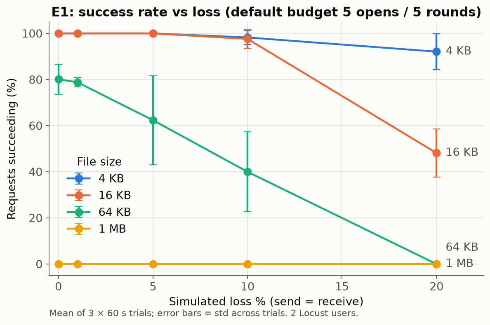
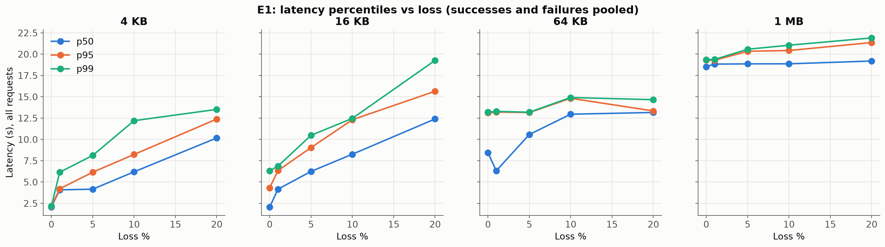
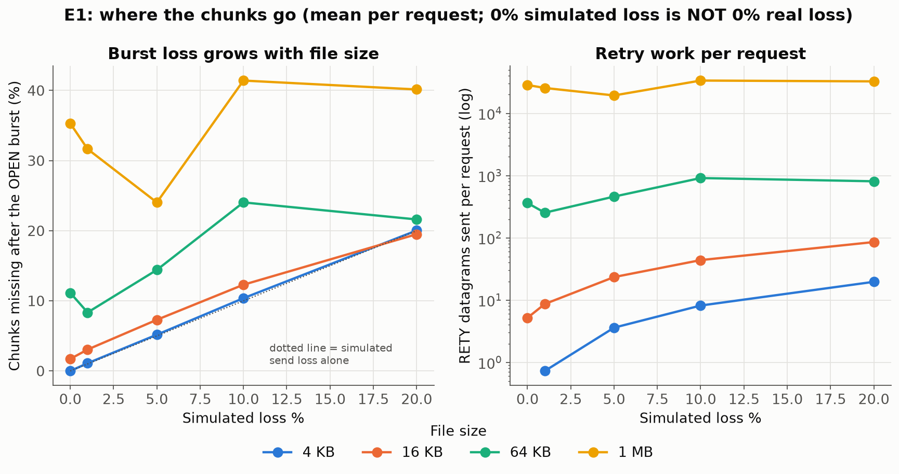
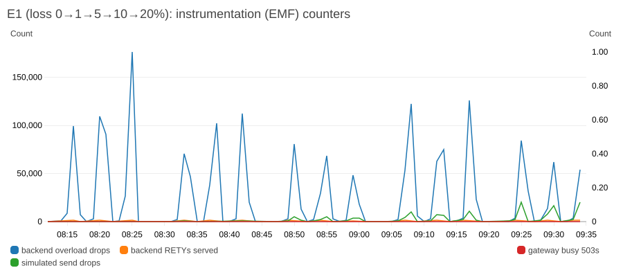

# E1: reliability under loss × file size

## Hypothesis

With the default budget (5 OPEN attempts, 5 RETY rounds, 2 s quiet timeout), success falls as loss rises, and it falls faster for bigger files, because more datagrams means more chunks to recover. I expected the budget to break around 10–20% loss for small files and much earlier for big ones.

## Variables

| | Values | Why |
|---|---|---|
| **Varied** | simulated loss `SEND_LOSS = RECV_LOSS` ∈ {0, 1, 5, 10, 20}% | symmetric loss models a lossy link: OPEN/RETY can be lost on the way in, chunks on the way out |
| **Varied** | file size ∈ {4 KB, 16 KB, 64 KB, 1 MB}, i.e. 64 / 256 / 1,024 / 16,384 datagrams | re-scoped from the planned {64 KB, 1 MB, 4 MB} after the smoke test showed 4 MB fails 100% at 0% loss ([native-loss-diagnosis.md](../notes/native-loss-diagnosis.md)) |
| Fixed | budget 5 / 5 / 2 s (stock), `WORKERS=8`, `MAX_INFLIGHT=4`, 2 gateway + 2 backend tasks (0.25 vCPU each) | isolate loss and size |
| Fixed | load: 2 Locust users, closed loop, 0.5 s think time | "low load": far below the gateway's 8 slots, so no 503s or scaling |

## Method

- Driver: [`scripts/e1_loss_size.py`](../scripts/e1_loss_size.py).
- For each loss level, the backend task definition is updated with the new `SEND_LOSS`/`RECV_LOSS`, and the driver waits for `services-stable` and healthy targets.
- Each of the 20 cells gets **3 trials × 60 s**, run in trial-major order (4 KB, 16 KB, 64 KB, 1 MB, then trial 2, and so on) so slow drift doesn't land on one size.
- Locust records every request plus the gateway's `X-*` stats headers to `requests.jsonl`. A 200 counts only if the body length matches.
- Totals: 60 runs and **1,044 requests**, 08:12:38–09:35:28 UTC. Exact per-run windows are in `results/run_ledger.csv`.
- CloudWatch metrics for the window are in [`results/E1/cloudwatch/cloudwatch_metrics.csv`](../results/E1/cloudwatch/cloudwatch_metrics.csv). Backend EMF counters per cell are in [`results/E1/backend_counters_by_cell.csv`](../results/E1/backend_counters_by_cell.csv) (script `e1_backend_attribution.py`).

## Results

*Figure E1-1: Mean success rate of 3 × 60 s trials per cell, with error bars showing the std across trials. 4 KB holds above 90% even at 20% loss. 16 KB is perfect up to 10% and then collapses to 48%. 64 KB is already at 80% with no simulated loss. 1 MB never succeeds.*

| Size | Loss | Requests | Success % (mean ± std over trials) | p50 / p95 / p99 latency (s) | Mean RETY rounds | Mean RETYs sent | Chunks missing after OPEN |
|---|---|---|---|---|---|---|---|
| 4 KB | 0 | 144 | 100 ± 0 | 2.07 / 2.14 / 2.17 | 0.00 | 0 | 0.0% |
| 4 KB | 5 | 74 | 100 ± 0 | 4.17 / 6.16 / 8.13 | 1.20 | 3.6 | 5.2% |
| 4 KB | 20 | 39 | 92 ± 8 | 10.17 / 12.39 / 13.52 | 3.44 | 19.7 | 20.0% |
| 16 KB | 0 | 123 | 100 ± 0 | 2.07 / 4.33 / 6.32 | 0.20 | 5.2 | 1.7% |
| 16 KB | 10 | 43 | 98 ± 4 | 8.26 / 12.31 / 12.47 | 3.05 | 43.9 | 12.3% |
| 16 KB | 20 | 29 | **48 ± 11** | 12.40 / 15.65 / 19.27 | 4.55 | 85.6 | 19.5% |
| 64 KB | 0 | 49 | **80 ± 6** | 8.45 / 13.12 / 13.20 | 2.41 | 363 | **11.1%** |
| 64 KB | 5 | 35 | 62 ± 19 | 10.58 / 13.16 / 13.19 | 3.97 | 460 | 14.4% |
| 64 KB | 10 | 30 | 40 ± 17 | 12.96 / 14.83 / 14.92 | 4.90 | 914 | 24.0% |
| 64 KB | 20 | 30 | 0 ± 0 | 13.16 / 13.34 / 14.66 | 5.00 | 810 | 21.6% |
| 1 MB | 0 | 24 | **0 ± 0** | 18.54 / 19.31 / 19.36 | 5.00 | 28,541 | **35.3%** |
| 1 MB | 20 | 20 | 0 ± 0 | 19.20 / 21.36 / 21.91 | 5.00 | 32,615 | 40.1% |

All 20 cells are in [`results/E1/summary_cells.csv`](../results/E1/summary_cells.csv), and per-trial values in `summary_trials.csv`.

*Figure E1-2: Latency percentiles (all requests, successes and failures pooled) per size. Latency climbs in 2 s steps, one per extra round. Failing cells sit at a flat ceiling: about 13 s for 64 KB (1 OPEN + 5 rounds, each ending in a 2 s quiet wait) and about 19–21 s for 1 MB (the same plus the time to send ~30,000 RETYs).*

*Figure E1-3: Left: percentage of chunks still missing after the first OPEN burst. The dotted line is what the simulated send loss alone would cause. 4 KB lies exactly on it. 64 KB and 1 MB sit 10–35 points above it **even at 0% simulated loss**, which is the native burst loss. Right: RETY datagrams sent per request (log scale). A 1 MB request fires about 20,000–34,000 RETYs.*

### Backend view (EMF counters, CloudWatch)

*Figure E1-4: CloudWatch widget of the instrumentation counters across the whole E1 window. Backend `OverloadDrops` (job queue full) spikes to ~175,000 per minute. Every spike lines up with a 1 MB run. `RETYs served` (orange) stays near the floor because the backend can only serve a few RETYs per second.*

| Cell (backend counters, overlap-weighted per cell) | Overload drops | RETYs served | % of incoming messages dropped by the full queue | Mean S3 GET per OPEN/RETY |
|---|---|---|---|---|
| 1 MB, 0% loss | 410,892 | 4,449 | 98.9% | 155 ms |
| 64 KB, 10% loss | 63,227 | 4,015 | 94.0% | 51 ms |
| 16 KB, 10% loss | 2,062 | 1,843 | 52.2% | 31 ms |

Other CloudWatch evidence for this window:
- ECS CPU/memory: [`E1_full_window_ecs_cpu_memory.png`](../screenshots/E1_full_window_ecs_cpu_memory.png)
- task counts: [`E1_full_window_ecs_running_desired_tasks.png`](../screenshots/E1_full_window_ecs_running_desired_tasks.png), steady at 2 + 2 except during the loss-level rollouts
- ALB requests and 5xx: [`E1_full_window_alb_requests_5xx.png`](../screenshots/E1_full_window_alb_requests_5xx.png). The 504s are Target 5XX: the gateway answers them, not the ALB.
- ALB TargetResponseTime: [`E1_full_window_alb_target_response_time.png`](../screenshots/E1_full_window_alb_target_response_time.png)
- NLB UDP flows and bytes: [`E1_full_window_nlb_flows_bytes.png`](../screenshots/E1_full_window_nlb_flows_bytes.png)

Locust report examples:
- [`E1_locust_report_loss05_64KB_trial1.png`](../screenshots/E1_locust_report_loss05_64KB_trial1.png): 12 requests, 5 failures (504), p50 13 s
- [`E1_locust_report_loss20_16KB_trial1.png`](../screenshots/E1_locust_report_loss20_16KB_trial1.png)

## Observations (tied to the code)

1. **The real enemy is burst loss, not simulated loss.**
   - At 0% simulated loss, 64 KB loses 11% of its chunks in the OPEN burst and 1 MB loses 35%. 4 KB loses 0%, and its curve sits exactly on the simulated-loss line.
   - `handleOpen` (`transfer-server/protocol/server.go:169-187`) sends every 64-byte chunk back-to-back with no pacing.
   - Loss rises with burst length, so file size amplifies loss **beyond** the per-datagram rate: a 1 MB OPEN is 16,384 datagrams in a fraction of a second.
   - The loss persists with a 1-vCPU gateway and with the NLB bypassed (native-loss diagnosis). It is therefore not the load balancer.
2. **Retries cannot catch up, because each RETY is expensive and the queue is tiny.**
   - Every RETY re-downloads the whole object from S3 (`handleRetry`, `server.go:192-196`): measured mean 31 ms for 16 KB, 51 ms for 64 KB and 155 ms for 1 MB.
   - The client sends *all* missing IDs at once (`udp-client.go:239`, `for _, id := range missing`) into a backend queue of `workers*4 = 32` (`server.go:92`). Everything beyond that is dropped silently (`server.go:127`).
   - For 1 MB, 98.9% of incoming RETYs were dropped. Each round recovers at most roughly (8 workers + 32 queued) chunks, minus loss, and needs ≥ 2 s (`readTimeout`, `udp-client.go:40`).
   - So a 64 KB file with ~110 missing chunks needs about 3 rounds, and with ~250 missing (10% loss) it needs more than 5, which is why it fails.
3. **The default budget breaks at a size-dependent point:**
   - 4 KB never really breaks (92% at 20%).
   - 16 KB breaks between 10% and 20% (98% to 48%, with mean rounds 4.55 out of 5).
   - 64 KB is already marginal at 0%.
   - 1 MB is impossible.

   Everything larger than a few KB lives at the edge of the 5-round budget.
4. **Latency is quantised in 2 s steps.** p50 at 0% loss is 2.07 s for 4 KB and 16 KB: one quiet timeout, since every round ends only after `readTimeout` of silence (`udp-client.go:328`). Each extra round adds 2 s, so p50 at 20% loss for 4 KB is 10.2 s. Failed requests pay the full budget before returning 504 (`statusFor`, `gateway.go:303-319`), so failure is *slower* than success.
5. **Open attempts rarely mattered at these loss rates** (mean 1.0–1.5 per request). One OPEN datagram is lost with probability p, while chunk loss compounds over hundreds of chunks. E2 tests this directly.
6. **Orphaned work (surprise):** backend counters show tens of thousands of overload drops during the *4 KB* runs that follow 1 MB runs. After a 1 MB client gives up (504), the backend keeps working through the remaining queued RETYs, each costing an S3 GET of 1 MB. The protocol has no cancel, and `Serve` processes whatever is queued.

## Threats to validity and limitations

- **Small samples for slow cells.** 1 MB and 64 KB cells have 20–49 requests each, because each request takes 13–20 s. The trial-to-trial std for 64 KB at 5–10% loss is 17–19 points. I report means ± std and do not claim fine differences, for example 64 KB at 0% vs 1%.
- **Native loss varies over time and placement.** The 1 MB first-pass loss is not monotonic in simulated loss (35% → 32% → 24% → 41% → 40%), which shows the native component drifts between runs. It also differs by gateway/backend pairing (one gateway task lost far more than the other in the diagnosis).
- **Approximate backend attribution.** The EMF counters are 10 s sums aggregated to 1-minute CloudWatch points and spread over runs by time overlap. Neighbouring runs share boundary minutes, and orphaned RETYs carry over between runs. These numbers are indicative, not per-request.
- **Quiet mode** removes per-datagram logging that stock code would do ([service-changes.md](../service-changes.md) §5), so absolute backend CPU is a bit lower than stock.
- **Locust runs from a laptop over the internet.** Client-side latency includes ~20–60 ms of WAN RTT, which is negligible against the 2 s quanta.
- **Equal loss on both directions** is one model. Asymmetric loss was not tested.
