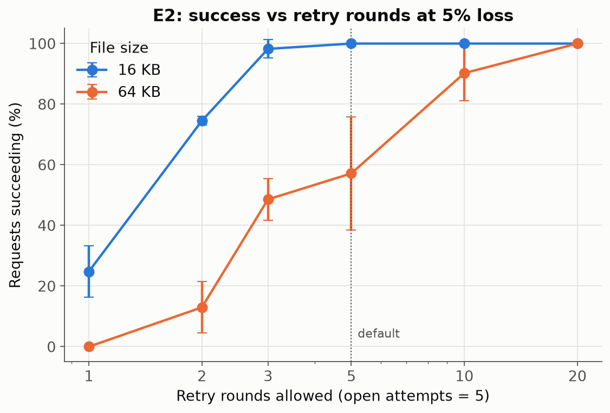
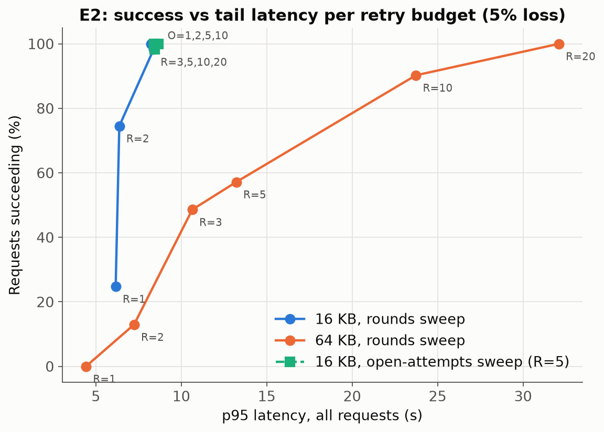
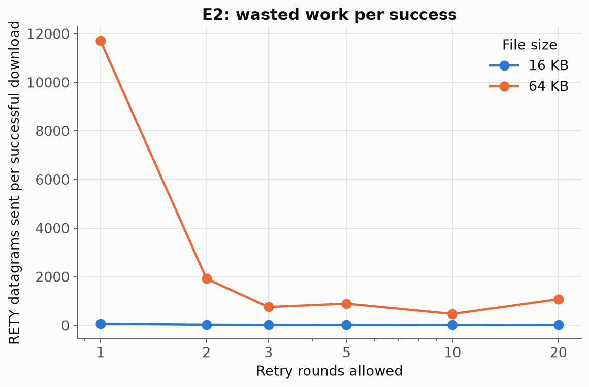

# E2: retry-budget trade-off

## Hypothesis

At a fixed, moderate loss, more retry rounds raise the success rate but add about 2 s of tail latency per round. Extra OPEN attempts matter much less, because a single OPEN datagram is rarely lost compared with hundreds of chunks. My guess was that the default (5 opens / 5 rounds) is near the knee for small files and far too low for 64 KB.

## Variables

| | Values | Why |
|---|---|---|
| **Varied (sweep A)** | retry rounds R ∈ {1, 2, 3, 5, 10, 20}, with open attempts = 5 | brackets the default (5) from both sides, on a log-spaced grid |
| **Varied (sweep A)** | file ∈ {16 KB, 64 KB} | 16 KB sits just inside the default budget and 64 KB just outside it, based on E1 |
| **Varied (sweep B)** | open attempts O ∈ {1, 2, 10} with R = 5 at 16 KB (O = 5 is shared with sweep A) | isolates the OPEN-retry knob |
| Fixed | loss `SEND_LOSS = RECV_LOSS = 5%` | E1 showed 5% is where size matters but small files still succeed |
| Fixed | 2 Locust users, 0.5 s think time, `READ_TIMEOUT_MS = 2000`, `WORKERS=8`, `MAX_INFLIGHT=4`, 2 + 2 tasks | as in E1 |

## Method

- Driver: [`scripts/e2_retry_budget.py`](../scripts/e2_retry_budget.py).
- The budget is set **per request** with the gateway's instrumentation hook (`?open_attempts=O&retry_rounds=R`, enabled by `ALLOW_BUDGET_OVERRIDE=1`; see [service-changes.md](../service-changes.md) §3). All 15 cells therefore ran on the same tasks without redeploying.
- Each `X-Budget` response header confirms the budget actually applied, for example `5/20/2000`.
- 15 cells × 3 trials × 60 s, in trial-major order. Window: 09:39:17–10:33:13 UTC (exact times in `results/run_ledger.csv`).
- One run (64 KB, R = 5, trial 3) was interrupted by the Terraform incident described in [service-changes.md](../service-changes.md#runtime-configuration-changes-made-during-the-experiments-not-code). It was deleted and re-run.

## Results

*Figure E2-1: Success rate vs allowed retry rounds at 5% loss (mean ± std over trials). 16 KB reaches 98% at R = 3 and 100% from R = 5. 64 KB gets only 57 ± 19% at the default R = 5 and needs R = 20 to reach 100%.*

*Figure E2-2: The trade-off curve, with success on the y-axis and p95 latency of all requests on the x-axis. Each point is one budget. For 16 KB the curve goes almost straight up: success is cheap, and p95 stays around 8–9 s whatever R is, because requests stop as soon as they are complete. For 64 KB each step up in success costs about 2 s per extra round: p95 goes from 13 s at R = 5 to 24 s at R = 10 (90%) and 32 s at R = 20 (100%). The open-attempt sweep (green squares) is a single cluster at 98–100% and ~8.5 s, so open attempts make almost no difference.*

*Figure E2-3: RETY datagrams sent per **successful** download, which is the backend work each delivered file costs, including the RETYs spent on requests that ended up failing. For 64 KB it is lowest at R = 10 (465), and both very low budgets (R = 1 wastes 11,706 per success) and R = 20 (1,068) cost more.*

CloudWatch for the E2 window: [`E2_full_window_emf_counters.png`](../screenshots/E2_full_window_emf_counters.png), [`E2_full_window_alb_target_response_time.png`](../screenshots/E2_full_window_alb_target_response_time.png), [`E2_full_window_ecs_cpu_memory.png`](../screenshots/E2_full_window_ecs_cpu_memory.png), [`E2_full_window_alb_requests_5xx.png`](../screenshots/E2_full_window_alb_requests_5xx.png), [`E2_full_window_nlb_flows_bytes.png`](../screenshots/E2_full_window_nlb_flows_bytes.png), [`E2_full_window_ecs_running_desired_tasks.png`](../screenshots/E2_full_window_ecs_running_desired_tasks.png). Locust example: [`E2_locust_report_64KB_R20_trial1.png`](../screenshots/E2_locust_report_64KB_R20_trial1.png).

*Table E2-1: All cells (from [`results/E2/summary_cells.csv`](../results/E2/summary_cells.csv)). Latency covers all requests. "RETYs per success" = all RETYs sent in the cell ÷ successful downloads.*

| File | Opens | Rounds | Trials | Requests | Success % (mean ± std) | p50 / p95 / p99 (s) | Mean rounds used | Mean OPENs | RETYs per success |
|---|---|---|---|---|---|---|---|---|---|
| 16 KB | 1 | 5 | 3 | 56 | 98 ± 3 | 6.2 / 8.4 / 9.6 | 2.07 | 1.00 | 22 |
| 16 KB | 2 | 5 | 3 | 54 | 100 ± 0 | 6.2 / 8.4 / 10.3 | 2.07 | 1.07 | 19 |
| 16 KB | 5 | 1 | 3 | 77 | 25 ± 9 | 4.2 / 6.2 / 6.3 | 1.00 | 1.06 | 69 |
| 16 KB | 5 | 2 | 3 | 59 | 75 ± 1 | 6.2 / 6.4 / 9.0 | 1.75 | 1.07 | 29 |
| 16 KB | 5 | 3 | 3 | 58 | 98 ± 3 | 6.2 / 8.4 / 9.2 | 1.93 | 1.02 | 20 |
| 16 KB | 5 | 5 | 3 | 56 | 100 ± 0 | 6.2 / 8.4 / 11.3 | 2.04 | 1.05 | 22 |
| 16 KB | 5 | 10 | 3 | 57 | 100 ± 0 | 6.2 / 8.2 / 10.4 | 1.91 | 1.05 | 17 |
| 16 KB | 5 | 20 | 3 | 56 | 100 ± 0 | 6.2 / 8.3 / 9.3 | 1.96 | 1.05 | 22 |
| 16 KB | 10 | 5 | 3 | 58 | 100 ± 0 | 6.2 / 8.7 / 10.5 | 1.90 | 1.03 | 21 |
| 64 KB | 5 | 1 | 3 | 78 | 0 ± 0 | 4.3 / 4.4 / 6.2 | 1.00 | 1.03 | 11,706 |
| 64 KB | 5 | 2 | 3 | 54 | 13 ± 8 | 6.4 / 7.2 / 9.4 | 2.00 | 1.07 | 1,919 |
| 64 KB | 5 | 3 | 3 | 45 | 49 ± 7 | 8.5 / 10.6 / 10.8 | 2.80 | 1.09 | 748 |
| 64 KB | 5 | 5 | 3 | 34 | 57 ± 19 | 12.8 / 13.2 / 14.4 | 4.21 | 1.06 | 885 |
| 64 KB | 5 | 10 | 3 | 33 | 90 ± 9 | 8.5 / 23.7 / 24.1 | 4.24 | 1.03 | 465 |
| 64 KB | 5 | 20 | 3 | 24 | 100 ± 0 | 15.1 / 32.1 / 34.0 | 7.21 | 1.00 | 1,068 |

## Observations (tied to the code)

1. **The budget that matters is retry rounds, and the right value depends on file size.**
   - The rounds loop is `udp-client.go:218` (`for round := 0; round < budget.RetryRounds; round++`).
   - At 5% loss a 64 KB request starts with about 150 missing chunks (E1).
   - Each round can recover only about 40 of them. The backend accepts `WORKERS + workers*4 ≈ 40` RETYs per burst and drops the rest (`protocol/server.go:92`, `:127`), and the replies themselves are subject to 5% loss.
   - So it needs roughly 4–10 rounds, and the default 5 lands it on a coin flip (57 ± 19% across trials).
   - 16 KB starts with ~19 missing chunks, which fits in one or two rounds.
2. **Each round costs a fixed 2 s or more of latency.** A round only ends after `readTimeout` of silence (`udp-client.go:328`). R = 20 buys 100% success for 64 KB at a p95 of 32 s. The ALB's 60 s idle timeout would cut off budgets above roughly 25 rounds, because the gateway sends nothing until the transfer finishes.
3. **Open attempts barely matter.** The measured mean is 1.0–1.1 OPENs per request in every cell. O = 1 gave 98% (1 failure in 56 requests, consistent with one lost OPEN), and O = 2, 5 and 10 all gave 100% at 16 KB. That matches the arithmetic: P(OPEN lost) is about 5%, the gateway re-sends OPEN on a fresh socket (`udp-client.go:194`), and the 2 s wait after a lost OPEN is the only cost.
4. **Is the default well chosen?** For files up to ~16 KB at ≤10% loss, yes. It is more than enough: R = 3 already gives 98%, and extra rounds are free because a complete request stops early. For 64 KB it is **too low under this server's design**, but raising R is a poor fix: it turns failures into 25–35 s successes and multiplies the backend's S3 GETs (one per RETY, `server.go:192-196`). The better fixes are server-side (see recommendations).
5. **Failures are slow.** A failed request uses its whole budget: about 4.3 s at R = 1 and about 13 s at R = 5. Low budgets therefore make failure fast and cheap, while high budgets make failure rare but slow.

## Threats to validity and limitations

- Samples: 24–78 requests per cell (3 trials each). Requests with bigger budgets are slower, so they get fewer samples per 60 s.
- The per-request override reproduces exactly what the `RETRY_ROUNDS`/`OPEN_ATTEMPTS` env vars do (same `Budget` struct and the same `fetch` loop). It does not test a whole fleet configured that way. In a fleet the extra RETY load would be correlated across clients.
- With only 2 users, the backend queue rarely sees two clients' RETY floods at once. Under heavier load each round would recover *fewer* chunks, so the knee would move further right.
- One loss level (5%) was tested. E1 shows how the starting point shifts with loss.
