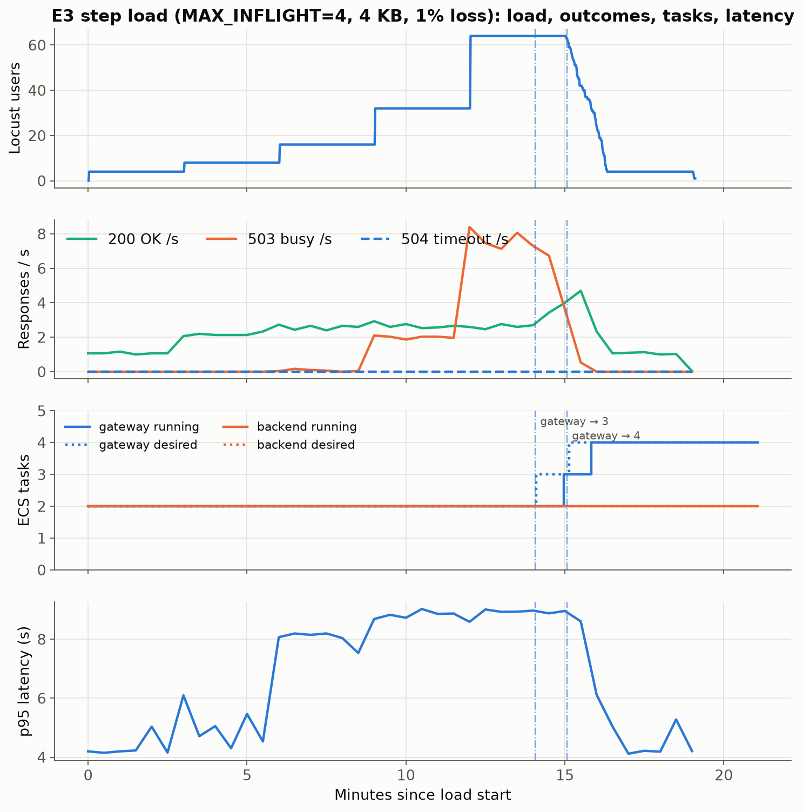
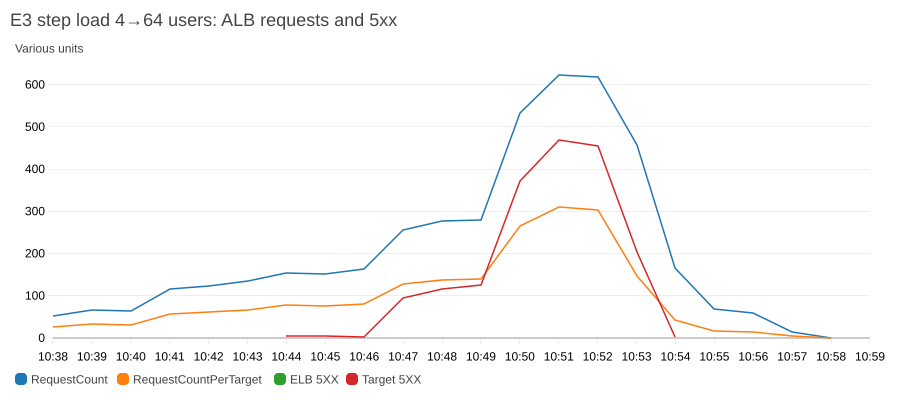
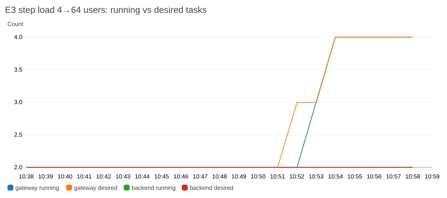
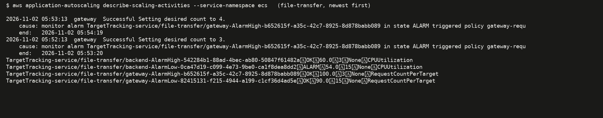

# E3: autoscaling under step load (gateway on ALB vs backend on NLB)

## Hypothesis

The gateway's capacity is fixed by `MAX_INFLIGHT = 4` slots per task, and each request holds a slot for at least the 2 s quiet timeout. One task can therefore complete only about 2 req/s (~120 req/min), and the gateway should saturate at around 8 concurrent users on 2 tasks.

I expected:
1. **503 "gateway busy" rejections before scaling kicks in.** Target tracking needs several 1-minute datapoints above target, then a task launch.
2. **The gateway scales out**, because `ALBRequestCountPerTarget` counts every request, including the fast 503s, so it rises quickly once rejections start.
3. **The backend does *not* scale**, because a 4 KB transfer costs it almost no CPU. The backend's real bottleneck is its job queue, which no ECS metric sees.

## Variables

| | Value | Why |
|---|---|---|
| **Varied** | load: Locust step shape 4 → 8 → 16 → 32 → 64 users (3 min each), then back to 4 users for 4 min, then 2 min of observation | steps longer than the 3-datapoint scale-out alarm, so each step can trigger a scale event |
| Fixed | file 4 KB (64 datagrams), loss 1% (send = recv) | E1: 4 KB has no burst loss, so latency comes from queueing rather than chunk recovery; 1% adds a realistic retry load |
| Fixed | gateway `MAX_INFLIGHT=4`, `QUEUE_WAIT=5 s`; backend `WORKERS=8` (config A = stock) | the stock configuration |
| Fixed | target tracking: gateway `ALBRequestCountPerTarget = 100`, backend `ECSServiceAverageCPUUtilization = 60%`, min 2 / max 4 each, **scale-out cooldown 60 s, scale-in cooldown 60 s** (scale-in lowered from 120 s; see [service-changes.md](../service-changes.md)) | stock thresholds; the cooldown change is only a time box |
| Fixed | Locust think time 0.5 s, closed loop (a 503 comes back fast, so a user retries quickly) | as in E1/E2 |

Config B (`MAX_INFLIGHT=16`) was planned but **not run**, to fit the time box. It is defined in `e3_scaling.py`.

## Method

Driver: [`scripts/e3_scaling.py`](../scripts/e3_scaling.py). The steps are:
1. Set backend loss to 1%.
2. Reset both services to 2 tasks, wait for stable, and settle for 60 s.
3. Run the Locust step shape.
4. In a background thread, poll `describe-services` (desired/running/pending) and target health every 10 s into `ecs_timeline.csv`.
5. Save the Application Auto Scaling activities.
6. Pull CloudWatch metrics and widget images for the window afterwards.

- Load window: 10:38:09–10:57:15 UTC, observed until 10:59:15.
- Volume: **4,370 requests**.
- Raw data in [`results/E3/configA/`](../results/E3/configA/):
  - `requests.jsonl`
  - `locust_stats_history.csv`
  - `ecs_timeline.csv`
  - `scaling_activities.json` / `.txt`
  - `target_tracking_alarms.txt`
  - `cloudwatch/cloudwatch_metrics.csv`
  - `summary_by_step.csv`

## Results

*Figure E3-1, four panels on a shared time axis:*
1. *Locust users (step shape).*
2. *Responses per second by outcome.*
3. *ECS running (solid) and desired (dotted) tasks for each service, polled every 10 s.*
4. *p95 latency in 30 s buckets.*

*Dash-dot lines mark the two scale-out activities. Successful throughput (green) is flat at about 2.6/s from 16 users on, while 503s (orange) climb to about 8/s. The gateway goes to 3 and then 4 tasks only about 5 minutes after the 503 surge, and the backend stays at 2 throughout.*

| Step (minutes) | Users | Requests | Success % | 503 busy | 504 | p50 / p95 (s), all requests | p95 (s), successes only |
|---|---|---|---|---|---|---|---|
| 0–3 | 4 | 193 | 100 | 0 | 0 | 4.08 / 4.20 | 4.20 |
| 3–6 | 8 | 390 | 100 | 0 | 0 | 2.83 / 5.06 | 5.06 |
| 6–9 | 16 | 477 | 97.5 | 12 | 0 | 5.54 / 8.15 | 8.16 |
| 9–12 | 32 | 843 | **57.2** | 361 | 0 | 6.08 / 8.82 | 9.02 |
| 12–15 | 64 | 1,850 | **26.9** | 1,353 | 0 | 5.04 / 8.93 | 9.07 |
| 15–20 | 64 → 4 (gateway now 3–4 tasks) | 617 | 79.7 | 125 | 0 | 5.03 / 8.83 | 8.89 |

*Figure E3-2: CloudWatch widget for the ALB. `RequestCount` and `RequestCountPerTarget` (Sum per minute) climb to 600+ and ~310. **`Target 5XX` (the gateway's 503s) accounts for most of that growth.** There are no ELB 5XX: the ALB itself never failed.*

*Figure E3-3: Container Insights `RunningTaskCount` / `DesiredTaskCount`. The gateway goes from desired 3 at 10:51–52 to 4, with running trailing desired by about 1 minute (Fargate launch plus health checks). The backend stays at 2.*

*Figure E3-4: Output of `aws application-autoscaling describe-scaling-activities` (times in EST) and the four target-tracking alarms. Both scale-outs were triggered by `gateway-AlarmHigh` on `RequestCountPerTarget > 100` for 3 of 3 datapoints. Scale-in (`AlarmLow`) needs **15** consecutive datapoints below 90.*

Other CloudWatch widgets for this window:
- ECS CPU and memory: [`E3_configA_ecs_cpu_memory.png`](../screenshots/E3_configA_ecs_cpu_memory.png)
- ALB TargetResponseTime: [`E3_configA_alb_target_response_time.png`](../screenshots/E3_configA_alb_target_response_time.png)
- NLB flows and bytes: [`E3_configA_nlb_flows_bytes.png`](../screenshots/E3_configA_nlb_flows_bytes.png)
- EMF counters: [`E3_configA_emf_counters.png`](../screenshots/E3_configA_emf_counters.png)

Locust report: [`E3_configA_locust_report.png`](../screenshots/E3_configA_locust_report.png).

Key CloudWatch values (1-minute points, from `cloudwatch_metrics.csv`):

| UTC | ALB RequestCountPerTarget | Target 5XX | gateway busy-503 (EMF) | gateway CPU avg | backend CPU avg / max | backend BusyWorkers (max) | gateway tasks running |
|---|---|---|---|---|---|---|---|
| 10:44–10:46 (16 users) | 76–82 | 3–5 | 3–5 | 1.1% | 1.3% / 1.9% | 4 | 2 |
| 10:47–10:49 (32 users) | **128–140** | 94–126 | 85–125 | 1.3% | 1.5% / 1.9% | 4–5 | 2 |
| 10:50–10:52 (64 users) | 266–312 | 372–469 | 360–465 | 1.7% | 1.5% / 1.9% | 4–7 | 2 |
| 10:53 | 146 | 204 | 231 | 1.0% | 1.9% / 2.5% | 4 | 3 |
| 10:54 | 42 | 2 | 3 | 0.8% | 1.7% / 2.9% | 4 | 4 |

## Observations (tied to the code)

1. **The gateway's capacity is a hard ceiling set by `MAX_INFLIGHT × tasks ÷ latency`.**
   - The semaphore (`gateway.go:141`, `make(chan struct{}, maxInFlight)`) allows 4 transfers per task. Each 4 KB transfer at 1% loss takes about 2–4 s, because every round ends with a 2 s quiet wait (`udp-client.go:328`).
   - So 2 tasks deliver about 8 slots ÷ ~3 s ≈ 2.7 successes per second. That is exactly the flat green line (150–165 per minute) from 16 users to 64 users.
   - Every request beyond that waits up to `QUEUE_WAIT = 5 s` (`gateway.go:206`) and then gets a 503. This is why p95 jumps from about 5 s to 8–9 s (5 s queue + ~3–4 s transfer) once the slots are full.
2. **The gateway scaled because of its own rejections, not because of demand.**
   - With only successful traffic, `RequestCountPerTarget` peaked at **82 per minute**, below the target of 100. A saturated gateway that rejected nothing would never have scaled.
   - It crossed 100 only when the 32-user step produced about 100 fast 503s per minute (10:47), since the ALB metric counts every response.
   - This is a fragile coupling: if clients backed off on `Retry-After` instead of retrying in 0.5 s, the metric would fall and scaling might never happen.
3. **Scale-out lag is about 5–7 minutes from overload to added capacity.**
   - The metric first exceeded the target at 10:47. The first scaling activity ran at 10:52:13, and the second (after the 60 s scale-out cooldown) at 10:53:13.
   - Tasks were running by about 10:53:20 and 10:54:19.
   - The lag comes from three stages: 3 alarm datapoints, then CloudWatch ingestion and evaluation delay (about 2 min), then Fargate launch and ALB health checks (2 × 10 s interval plus the 30 s grace period).
   - During those ~6 minutes, **1,771 requests were rejected** (10:47:00–10:53:20).
   - Once capacity reached 4 tasks, successful throughput rose to about 4.7/s, but by then the load step was ending.
4. **The backend never scaled, and the CPU target is blind to its bottleneck.**
   - Backend CPU never exceeded 2.9% (target 60%). Gateway CPU never exceeded 1.8%.
   - Both tiers are **I/O- and timer-bound**: the gateway waits on 2 s quiet timeouts, and backend workers wait on S3 GETs (`fetchSource` in `handleOpen`/`handleRetry`).
   - Yet backend `BusyWorkers` reached **7 of 8** at peak, so the worker pool was nearly saturated while CPU read about 2%. With larger files or more loss (E1/E2), the queue overflows (`OverloadDrops`) long before CPU moves.
   - The NLB offers no request metric (only `ActiveFlowCount_UDP`, `ProcessedBytes`), so the stock policy has nothing better. A custom-metric policy on the EMF `BusyWorkers` or `OverloadDrops` would track the real bottleneck.
5. **Scale-in did not start within the window, as expected.** Lowering the scale-in cooldown to 60 s doesn't help, because a target-tracking scale-in waits for `AlarmLow` (15 consecutive minutes below 90% of target). The run ended 4 minutes after the load dropped, with the gateway still at 4 tasks (`target_tracking_alarms.txt`: gateway AlarmLow `OK`). At that point the backend's AlarmLow was in `ALARM`, but the backend was already at its minimum.
6. **No 504s at all.** With 4 KB files at 1% loss, every admitted request finished within the budget. The failure mode under load is *admission* (503), not transfer.

## Threats to validity and limitations

- **One run, one configuration.** This is a single time series. Variance comes only from within-step samples, and step boundaries interact with the 1-minute metric buckets. Config B (`MAX_INFLIGHT=16`) was not run.
- **Closed-loop load amplifies 503s.** Locust users retry 0.5 s after a 503 and ignore `Retry-After: 1`. Open-loop or back-off clients would produce fewer 503s and a lower request-count metric, so possibly *no* scaling at all.
- **The load came from one laptop.** At 64 users the client was not a bottleneck: requests were mostly idle waits. But this is not a distributed load test.
- **Instrumentation artefact:** the EMF `InFlight` gauge reports a maximum of 5 per task, one more than the semaphore allows. The handler frees the slot before decrementing the gauge (`defer func(){ <-inflight; mInflight.Add(-1) }()`), so a new request can increment first. The true concurrency limit is 4.
- **Scale-in cooldown** was 60 s instead of the stock 120 s. This doesn't affect scale-out.
