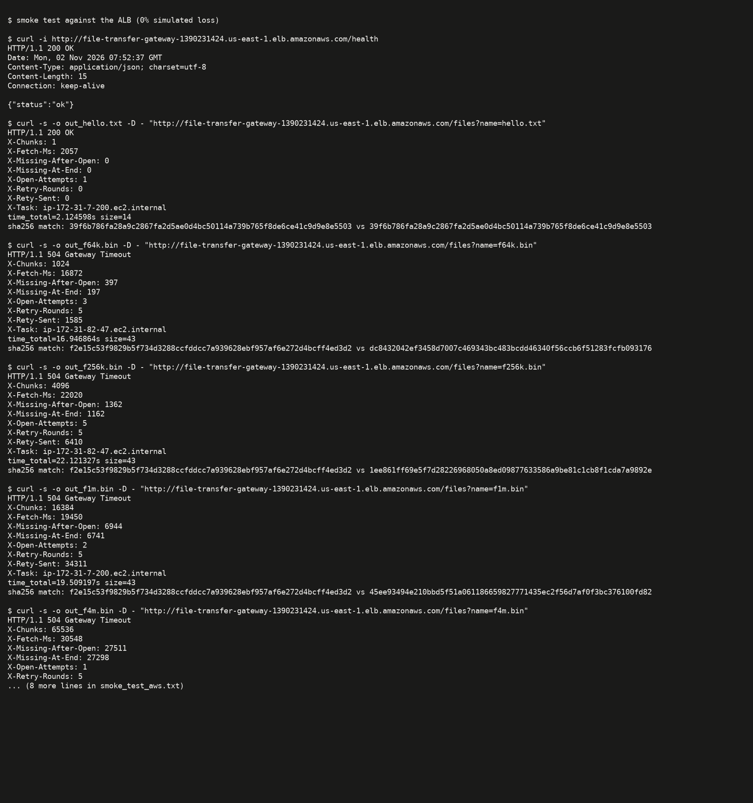

# Unplanned finding: datagram loss on AWS with 0% simulated loss

## What happened

The first smoke test against the ALB used **stock settings and `SEND_LOSS=RECV_LOSS=0`**. Raw output: [`results/deploy/smoke_test_aws.txt`](../results/deploy/smoke_test_aws.txt).

| File | Chunks | Missing after OPEN | Missing at end (after 5 rounds) | Result |
|---|---|---|---|---|
| hello.txt | 1 | 0 | 0 | 200 in 2.1 s |
| 64 KB | 1,024 | 397 | 197 | **504** in 16.9 s |
| 256 KB | 4,096 | 1,362 | 1,162 | **504** in 22.1 s |
| 1 MB | 16,384 | 6,944 | 6,741 | **504** in 19.5 s |
| 4 MB | 65,536 | 27,511 | 27,298 | **504** in 30.6 s |

*Figure N-1: Smoke test against the ALB at 0% simulated loss. `hello.txt` succeeds and is byte-identical (sha256 match). 64 KB and larger return 504, with `X-Missing-After-Open` already 39–42% of chunks.*

Locally (loopback), the same build delivers 64 KB and 1 MB with no retries at 0% loss. On AWS, roughly 10–40% of each OPEN burst is lost **before any simulated loss is applied**.

## Narrowing down where the loss happens (about 15 min of diagnosis)

| Test | First-pass loss, 64 KB / 256 KB / 1 MB | Conclusion |
|---|---|---|
| Stock: gateway 0.25 vCPU, via NLB | 0–44% / ~33% / ~42% (varies by request) | baseline |
| Gateway **1 vCPU / 2 GB**, via NLB ([raw](../results/deploy/diag_gateway_1vcpu_first_pass_loss.txt)) | 0–56% (median ~12%) / 5–30% (median ~18%) / 13–40% (median ~26%) | gateway CPU throttling is **not** the main cause |
| Gateway 1 vCPU, **NLB bypassed** (UPSTREAM = one backend task IP) ([raw](../results/deploy/diag_direct_backend_no_nlb_first_pass_loss.txt)) | 0–13% / 9–16% / 16–29% | the **NLB is not** the cause; loss persists host to host |

The backend's EMF counters show `DatagramsSent` equal to the number of chunks (for example 65,597 for one 4 MB OPEN) with `SendErrors = 0`. `sendto` succeeded every time, so the datagrams are lost **after** the server's socket: in the hosts' network path or the receiver's socket buffer.

**Most likely mechanism:** `handleOpen` (`transfer-server/protocol/server.go`) sends every chunk back-to-back with no pacing. A 1 MB file is 16,384 small (~80 B) datagrams sent as fast as the CPU allows. On the receiving side:
1. The default UDP receive buffer (~208 KB, which holds only a few hundred small datagrams because of per-packet kernel overhead) overflows whenever the reader goroutine falls behind.
2. Fargate/ENA packet-per-second allowances drop microbursts.

Loss grows with burst length (file size), which matches both explanations. I did not separate the two further: kernel counters such as `netstat -su` are not reachable inside a distroless Fargate task.

**Why the retry logic cannot repair it:**
- Every `RETY` re-downloads the whole object from S3. Measured mean `SourceFetchMs` was about 67 ms for 1 MB and about 485 ms for 4 MB.
- The backend handles at most `WORKERS=8` RETYs at a time and buffers 32 more.
- A retry round fires *all* missing IDs at once (for example 34,311 RETYs for 1 MB), so the backend logged up to **16,306 `OverloadDrops` per 10 s**. Each round recovers only a few hundred chunks at best.

## Effect on the experiment design

The originally planned E1 sizes (64 KB / 1 MB / 4 MB) would have shown roughly "0% success everywhere except some 64 KB requests". I re-scoped as follows (logged in [checkpoint-log.md](checkpoint-log.md)):

- **E1** sizes became **4 KB, 16 KB, 64 KB, 1 MB**. 4 MB is dropped because it fails 100% even at 0% loss (shown above), and 1 MB is kept as the "dead" reference.
- **E2** uses 16 KB and 64 KB at **5%** simulated loss, where the budget actually matters.
- **E3** uses a **4 KB** file, so the load test measures scaling, not burst loss.

All experiments ran on the **stock** task size (gateway and backend 0.25 vCPU / 0.5 GB). The diagnostic task definitions (revisions 2–4 of `file-transfer-gateway`) were rolled back to revision 5: stock size, NLB upstream. One diagnostic rollout briefly used a wrong placeholder `UPSTREAM`. It was replaced before any experiment traffic.
