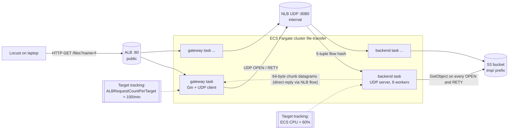

# Service overview: file-transfer-playservice

Fork: <https://github.com/nikhilsk98/file-transfer-playservice>. Experiments ran on branch `midterm-instrumentation`.
Upstream: <https://github.com/dnunez02/file-transfer-playservice>. Source paths below are relative to the fork root.

## Architecture



- **Gateway** (`transfer-frontend/`): a Gin HTTP server. Each `GET /files` takes a slot in a counting semaphore of size `MAX_INFLIGHT`, then runs the FTP_6650 UDP client (`transfer-client/udp`) against the NLB.
- **Backend** (`transfer-server/`): one UDP socket and a reader goroutine that pushes each datagram into a buffered `jobs` channel of capacity `workers*4`. `WORKERS` goroutines handle the jobs, and every `OPEN` or `RETY` downloads the whole object from S3. The health check is HTTP on TCP 8081, because an NLB cannot health-check UDP.
- **Load balancers:** the ALB (HTTP) fronts the gateway. The internal NLB (UDP 8080, target type `ip`, client IP preserved) fronts the backend. A UDP "flow" is pinned to one backend by its 5-tuple, so all `RETY`s on the same socket reach the same backend. The client re-dials (new source port, so possibly a new backend) only after a silent round.

## Request flow (one GET)

1. ALB → gateway task. The gateway validates the name, then waits up to `QUEUE_WAIT` (5 s) for an in-flight slot. If none frees up, it returns **503** "gateway busy" (`gateway.go` `handleGetFile`).
2. **OPEN phase** (`udp-client.go` `fetch`): the client sends `OPEN <name>` on a fresh socket. It then reads datagrams until the server has been silent for `readTimeout` (2 s), and repeats on a new socket up to `maxOpenAttempts` (5) times if nothing arrived.
3. The backend's `handleOpen` fetches the object from S3, splits it into **64-byte chunks**, and sends each chunk once as `<id> <n> <size> <64 bytes>`. A 4 MB file is 65,536 datagrams.
4. **RETY phase:** for up to `maxRetryRounds` (5) rounds, the client sends one `RETY <name> <id>` per missing chunk (all at once), then reads until 2 s of silence. If a round brought nothing, the next round re-dials first.
5. The backend's `handleRetry` re-fetches the **whole object from S3 for every RETY** and sends one chunk. If the job queue (32 slots) is full, the datagram is silently dropped ("Overloaded", `protocol/server.go` `Serve`).
6. Outcomes:
   - all chunks received: **200**
   - `ERR file-not-found`: 404
   - any other `ERR`: 502
   - no data after all OPENs, chunks still missing after all rounds, or a socket error: **504** (`statusFor`)

**Latency floor:** every successful request pays at least one 2 s quiet timeout, plus 2 s for each extra open attempt or retry round. The worst case at defaults is about (5 + 5) × 2 s = 20 s, plus transfer time.

## Tunable parameters

| Parameter | Where in code | Default | How to change (as deployed) |
|---|---|---|---|
| Send loss % (backend drops outgoing datagrams) | `transfer-server/udp/udp-transport.go` `Send`, parsed in `udp-server.go` | 0 | env `SEND_LOSS` on the backend task (Terraform `backend_send_loss`) |
| Receive loss % (backend drops incoming OPEN/RETY) | `udp-transport.go` `Receive` | 0 | env `RECV_LOSS` (Terraform `backend_recv_loss`) |
| Chunk size | `transfer-data/tcp-pack.go` `CHUNK_SIZE` | 64 B | code constant (protocol-level, not changed) |
| Max file size | `transfer-client/udp/udp-client.go` `maxChunks` | 65,536 chunks = 4 MiB | code constant |
| Open attempts | `udp-client.go` `maxOpenAttempts` | 5 | **was a constant**; now env `OPEN_ATTEMPTS` or the per-request query `open_attempts` (instrumentation) |
| Retry rounds | `udp-client.go` `maxRetryRounds` | 5 | **was a constant**; now env `RETRY_ROUNDS` or the query `retry_rounds` |
| Quiet/read timeout per round | `udp-client.go` `readTimeout` | 2 s | **was a variable for tests only**; now env `READ_TIMEOUT_MS` or the query `read_timeout_ms` |
| Gateway max in-flight transfers per task | `transfer-frontend/main.go` → `gateway.New` semaphore | 4 | env `MAX_INFLIGHT` (Terraform `max_inflight`) |
| Gateway queue wait before 503 | `gateway.DefaultQueueWait` | 5 s | env `QUEUE_WAIT` (Terraform `gateway_queue_wait`, added) |
| Backend workers (max in-flight requests) | `udp-server.go` `-workers` → `protocol.Serve` | 8 | env `WORKERS` (Terraform `backend_workers`) |
| Backend job queue | `protocol/server.go` `make(chan job, workers*4)` | 32 | derived from `WORKERS` |
| Gateway scaling metric / target | `terraform/autoscaling.tf` `ALBRequestCountPerTarget` | 100 req/min/target | Terraform `gateway_requests_per_target` |
| Backend scaling metric / target | `autoscaling.tf` `ECSServiceAverageCPUUtilization` | 60 % | Terraform `backend_cpu_target` |
| Min / max tasks | `autoscaling.tf` `aws_appautoscaling_target` | 2 / 4 each | Terraform `gateway_min/max`, `backend_min/max` |
| Scale-out / scale-in cooldown | `autoscaling.tf` | 60 s / 120 s | Terraform `scale_out_cooldown` / `scale_in_cooldown` (made variables) |
| LB deregistration delay | `alb.tf`, `nlb.tf` | 60 s | Terraform `deregistration_delay` (made a variable; 30 s used) |
| Task size | `ecs.tf` | 0.25 vCPU / 0.5 GB, X86_64 | Terraform (not varied) |

To change environment variables cheaply between runs, `scripts/common.py set_service_env()` clones the running task definition with the new values, calls `update-service`, and waits for `services-stable` and healthy targets.

## CloudWatch metrics available per tier

| Tier | Built-in metrics | Added by instrumentation (namespace `FileTransfer`, dimension `Service`) |
|---|---|---|
| ALB (gateway front) | `RequestCount`, `RequestCountPerTarget`, `TargetResponseTime`, `HTTPCode_Target_2XX/4XX/5XX_Count`, `HTTPCode_ELB_5XX/503/504_Count`, `HealthyHostCount` | – |
| Gateway ECS service | `AWS/ECS` CPUUtilization, MemoryUtilization; Container Insights `RunningTaskCount`, `DesiredTaskCount`, `PendingTaskCount` | `Requests`, `Responses200`, `RejectedBusy503`, `Timeout504`, `OtherErrors`, `OpenAttempts`, `RetryRounds`, `RetyRequestsSent`, `InFlight` (max), `WaitingForSlot` (max) |
| NLB (backend front) | `ActiveFlowCount_UDP`, `NewFlowCount_UDP`, `ProcessedBytes_UDP`, `ProcessedPackets`, `HealthyHostCount`. **No per-request metric**, which is why the backend scales on CPU. | – |
| Backend ECS service | CPU, memory, task counts as above | `OpenRequests`, `RetyRequests`, `OverloadDrops`, `MessagesAccepted`, `DatagramsSent`, `SimulatedSendDrops`, `SimulatedRecvDrops`, `SourceFetches`, `SourceFetchMsTotal`, `BusyWorkers` (max), `QueuedJobs` (max) |

Per-request data is exposed by the gateway as response headers (`X-Open-Attempts`, `X-Retry-Rounds`, `X-Rety-Sent`, `X-Missing-After-Open`, `X-Missing-At-End`, `X-Queue-Wait-Ms`, `X-Fetch-Ms`, `X-Task`, ...). Locust records them per request to `requests.jsonl`, and the gateway also logs one JSON `{"evt":"fetch",...}` line per request.

## Local smoke test (before AWS)

```
$ bin/backend udp -dir=<files> -port=9080 -health-port=9081 &
$ bin/gateway -transport=udp -upstream=localhost:9080 -listen=:9082 &
$ curl "http://localhost:9082/files?name=my-file.txt"   -> "hello there"  [200, 2.004 s]
$ curl .../files?name=f64k.bin                            -> 200, 2.10 s, byte-identical (cmp)
$ curl .../files?name=nope.txt                            -> 404 {"error":"file not found"}
```

Local probes (macOS loopback, files on disk, not S3):

| Loss | 64 KB | 1 MB | 4 MB |
|---|---|---|---|
| 0% | 200, 2.1 s | 200, 3.5 s | 200, 7.9 s (even with no simulated loss, some chunks are lost in the socket buffer) |
| 10% | 200, 10.2 s | **504**, 13.8 s | **504**, 19.2 s |

The 10% runs produced 18,210 "Overloaded" drops at the backend against 4,598 RETYs served. This is the first evidence that the 32-slot job queue, not the retry count, limits recovery.
